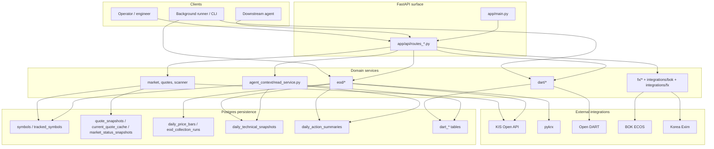
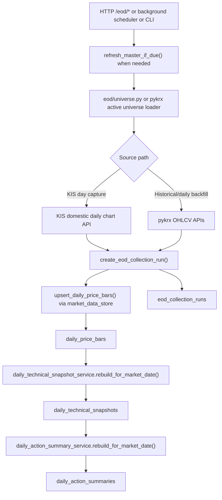
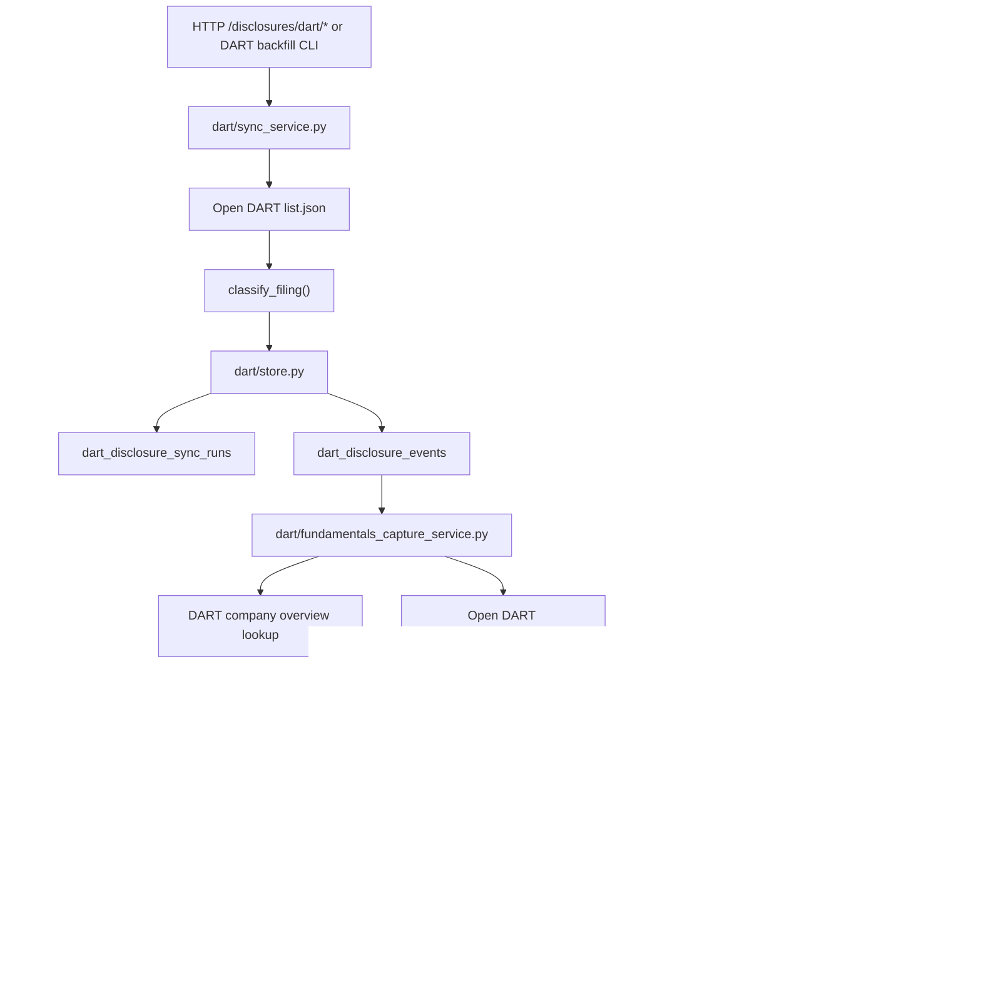
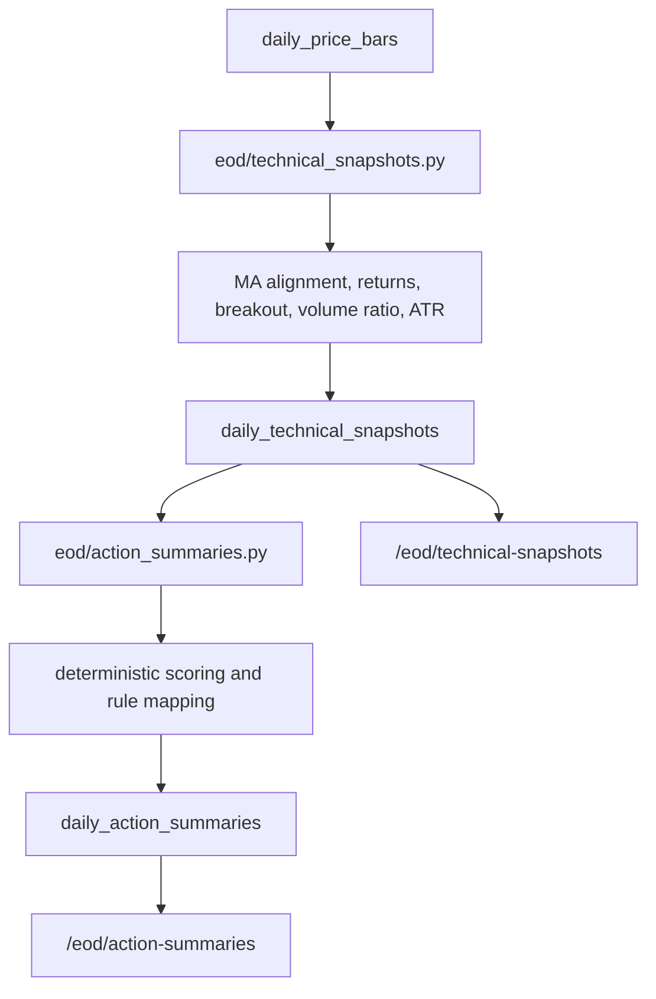
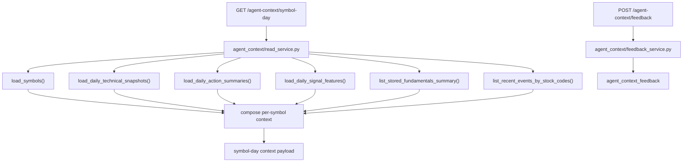
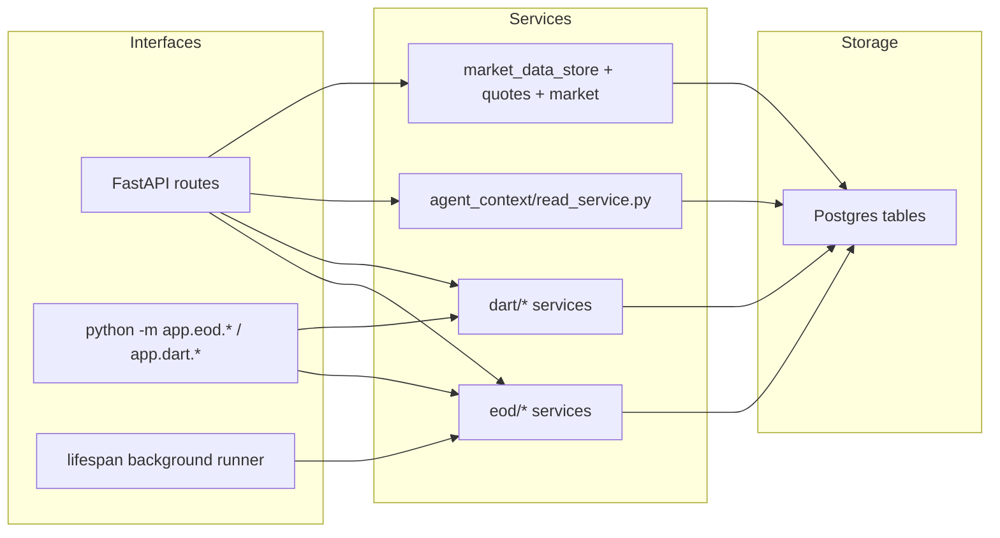

# Repository Architecture

This document explains how `kai-trading-core` is organized today, with emphasis on the implemented layers that persist market facts, compute deterministic post-EOD context, and expose machine-readable APIs for operators and downstream agents.

Scope:

- Repository and module layout
- Service layers and responsibility boundaries
- HTTP API, CLI, and background job entry points
- Persistence model by subsystem
- Implemented data flows for EOD, DART, technical snapshots, action summaries, and agent context

Non-goals:

- Frontend/web UI design
- Live order execution
- Future roadmap architecture that is not yet implemented in this repo

## Top-Level Repository Shape

| Path | Purpose |
| --- | --- |
| `apps/api/` | Python service root for the FastAPI application and domain modules |
| `apps/api/app/main.py` | App bootstrap, middleware, router registration, and lifespan startup/shutdown |
| `apps/api/app/api/` | HTTP route modules grouped by external or domain surface |
| `apps/api/app/core/` | Settings and audit logging infrastructure |
| `apps/api/app/db.py` | SQLAlchemy engine/session setup and DB bootstrap helpers |
| `apps/api/app/db_models.py` | Core relational schema used by ingestion, read models, and inspections |
| `apps/api/app/market_data_store.py` | Shared persistence helpers for symbols, quotes, market status, bars, technicals, and action summaries |
| `apps/api/app/eod/` | Master refresh, KIS/pykrx EOD ingestion, scheduler, and deterministic post-EOD computations |
| `apps/api/app/dart/` | DART company lookup, disclosure sync, fundamentals capture/history, and backfill runners |
| `apps/api/app/agent_context/` | Aggregate read layer for symbol-day machine context |
| `apps/api/app/brokers/kis/` | KIS Open API client/provider integration |
| `apps/api/app/integrations/` | External client integrations for BOK/ECOS, DART, and Korea Exim |
| `apps/api/tests/` | Route/service tests for implemented backend behavior |
| `docs/` | Implementation-oriented docs, architecture notes, MVP notes, and operator docs |

## System Layers

The current backend is a modular monolith. The layers are separated by responsibility rather than by separate deployables.

## Runtime Entry Points

### HTTP API

`apps/api/app/main.py` is the single process entry point. It is responsible for:

- creating the FastAPI app
- registering middleware for bearer auth and audit logging
- initializing the database on startup
- hydrating scanner state from persisted tracked symbols
- starting and stopping the background EOD runner
- registering all route modules

Current route modules:

| Route module | Prefix | Primary responsibility |
| --- | --- | --- |
| `app/api/routes_kis.py` | `/broker/kis` | KIS health, token, and quote passthrough |
| `app/api/routes_market.py` | `/market` | Market clock snapshot |
| `app/api/routes_quotes.py` | `/quotes` | Single-symbol and tracked quote retrieval |
| `app/api/routes_scanner.py` | `/scanner` | Tracked symbol read/write surface |
| `app/api/routes_symbols.py` | `/symbols` | Search against the loaded master universe |
| `app/api/routes_eod.py` | `/eod` | Master refresh, EOD capture, pykrx runs, technical snapshots, action summaries |
| `app/api/routes_dart.py` | `/disclosures/dart` | DART lookup, sync, capture, history, and artifact download |
| `app/api/routes_agent_context.py` | `/agent-context` | Aggregate symbol/day machine context |
| `app/api/routes_macro.py` | `/macro` | BOK ECOS series access |
| `app/api/routes_fx.py` | `/fx/koreaexim` | Korea Exim rates access |

### Background jobs inside the API process

The API process owns one recurring background loop:

- `app/eod/runner.py`
  - checks market state every `EOD_AUTO_PYKRX_POLL_SECONDS`
  - refreshes the KIS master during `PREOPEN`
  - asks the pykrx scheduler to run when the market is `CLOSED`

Supporting scheduler modules:

- `app/eod/auto_pykrx.py`
  - decides whether the daily pykrx collection is due
  - records scheduler status for `/eod/status`
  - runs the daily pykrx collection in a background task
- `app/eod/state.py`
  - in-memory status for KIS-style EOD collection
- `app/eod/master_state.py`
  - in-memory status for master refresh

### CLI / operator job entry points

These are the implemented command-line paths that matter for data operations:

| Module | Purpose |
| --- | --- |
| `python -m app.eod.pykrx_backfill` | Refresh universe, historical backfill, or daily pykrx collection |
| `python -m app.eod.technical_snapshots` | Recompute deterministic technical snapshots for a market date |
| `python -m app.eod.action_summaries` | Recompute deterministic action summaries for a market date |
| `python -m app.dart.backfill_current_universe` | Run one DART current-universe backfill batch |
| `python -m app.dart.backfill_current_universe_runner` | Run repeated DART current-universe backfill batches with progress logging |

The CLI and HTTP entry points both feed the same service modules; the doc-worthy point is that this repo does not maintain a separate worker service yet.

## Core Persistence Model

The DB schema in `apps/api/app/db_models.py` forms the real backbone of the architecture. The main table groups are:

### Market identity and quote state

- `symbols`
- `tracked_symbols`
- `quote_snapshots`
- `current_quote_cache`
- `market_status_snapshots`

These support universe identity, scanner state, quote history, current quote cache, and market-clock snapshots.

### EOD collection and derived post-EOD context

- `eod_collection_runs`
- `daily_price_bars`
- `daily_technical_snapshots`
- `daily_action_summaries`
- `daily_signal_features`

These tables store raw durable EOD bars, deterministic read models derived from those bars, and daily KIS ranking signal features keyed by symbol/date.

### DART disclosure and fundamentals persistence

- `dart_disclosure_sync_runs`
- `dart_disclosure_events`
- `dart_fundamentals_capture_runs`
- `dart_fundamentals_snapshots`
- `dart_fundamentals_rows`
- `dart_fundamentals_highlights`

These tables separate:

- sync-run audit from event storage
- capture-run audit from normalized fundamentals storage
- summary highlights from full statement rows

That split is what makes the later history APIs and agent-context aggregation possible without repeated live DART calls.

## Implemented Layer Breakdown

### 1. App bootstrap and cross-cutting infrastructure

Key modules:

- `apps/api/app/main.py`
- `apps/api/app/core/settings.py`
- `apps/api/app/core/audit_logging.py`
- `apps/api/app/db.py`

Responsibilities:

- environment loading and config normalization
- bearer-token protection for inbound requests
- request-id propagation
- rotating file audit logs for inbound API traffic and upstream HTTP calls
- DB health checks and startup initialization

### 2. Market identity, scanner, and quote access

Key modules:

- `apps/api/app/market_data_store.py`
- `apps/api/app/market/clock.py`
- `apps/api/app/quotes/service.py`
- `apps/api/app/quotes/cache.py`
- `apps/api/app/scanner/state.py`
- `apps/api/app/eod/master.py`

Responsibilities:

- maintain symbol identity and active universe rows
- maintain tracked scanner symbols
- fetch and persist quote snapshots
- persist market state snapshots
- expose the current KIS master-based symbol search surface

Important note:

- `app/eod/master.py` is both an EOD dependency and a general symbol-identity source, because routes like `/symbols/search` and the EOD universe logic depend on the master list being available.

### 3. EOD ingestion layer

Key modules:

- `apps/api/app/eod/service.py`
- `apps/api/app/eod/sink.py`
- `apps/api/app/eod/universe.py`
- `apps/api/app/eod/pykrx_backfill.py`
- `apps/api/app/market_data_store.py`

Responsibilities:

- KIS-driven day capture for the resolved universe
- pykrx-driven historical bar backfill
- pykrx-driven daily post-close collection
- persistence of bars and run metadata
- safe run gating and stale-run handling for the pykrx path

Important split:

- `app/eod/service.py` is the older KIS-driven direct day-capture path
- `app/eod/pykrx_backfill.py` is the broader durable bar ingestion path used for historical and daily runs

### 4. Post-EOD deterministic computation layer

Key modules:

- `apps/api/app/eod/technical_snapshots.py`
- `apps/api/app/eod/action_summaries.py`

Responsibilities:

- convert stored bars into deterministic chart-state summaries
- convert deterministic technical snapshots into deterministic action summaries
- persist reusable context rows keyed by `symbol + market_date`

This layer intentionally stops before discretionary reasoning. It creates stable, reproducible facts for agents and humans to consume.

### 5. DART ingestion and read layer

Key modules:

- `apps/api/app/dart/service.py`
- `apps/api/app/dart/sync_service.py`
- `apps/api/app/dart/store.py`
- `apps/api/app/dart/fundamentals_capture_service.py`
- `apps/api/app/dart/fundamentals_store.py`
- `apps/api/app/dart/fundamentals_history_service.py`

Responsibilities:

- company lookup and filing artifact download
- recent disclosure-event sync from Open DART
- classification of financial vs non-financial filings
- fundamentals capture from stored financial-report events
- persistence of snapshot, row, and highlight datasets
- stored-history retrieval across symbols and date windows

Important split:

- `sync_service.py` gets and classifies filing events
- `fundamentals_capture_service.py` consumes stored events and stores statement datasets
- `fundamentals_history_service.py` is read-side only

### 6. Agent-context aggregate read layer

Key modules:

- `apps/api/app/agent_context/read_service.py`
- `apps/api/app/api/routes_agent_context.py`

Responsibilities:

- assemble a symbol/day context packet for one or more symbols
- combine company metadata, same-day technical snapshot, same-day action summary, latest eligible fundamentals snapshot, and recent disclosures
- ensure recent disclosures are cut off at the requested `market_date`

Boundary:

- this layer aggregates and packages stored information
- it does not rank symbols, generate final trade decisions, or make live upstream calls by default

## EOD Data Flow

This is the implemented bar-ingestion path at a systems level.

Concrete code anchors:

- `apps/api/app/eod/service.py`
- `apps/api/app/eod/pykrx_backfill.py`
- `apps/api/app/eod/technical_snapshots.py`
- `apps/api/app/eod/action_summaries.py`
- `apps/api/app/market_data_store.py`

## DART Ingestion and Fundamentals Flow

The DART path is deliberately multi-stage so raw event discovery and fundamentals capture can be rerun independently.

Concrete code anchors:

- `apps/api/app/dart/sync_service.py`
- `apps/api/app/dart/store.py`
- `apps/api/app/dart/fundamentals_capture_service.py`
- `apps/api/app/dart/fundamentals_store.py`
- `apps/api/app/dart/fundamentals_history_service.py`
- `apps/api/app/dart/service.py`

## Technical Snapshot and Action Summary Flow

These two layers are separate on purpose. The action summary consumes the stored technical snapshot rather than recomputing from bars directly.

Key implementation details:

- technical snapshots require stored bars ending exactly on the requested `market_date`
- action summaries require stored technical snapshots for that same date
- both layers persist idempotent symbol/date rows via upsert-style storage helpers in `market_data_store.py`

## Agent-Context Read Layer Composition

This is the main machine-facing aggregate read layer added on top of the stored facts.

Returned composition per symbol:

- company identity: symbol, Korean name, market, instrument type
- technical snapshot for the requested day
- action summary for the requested day
- latest eligible DART fundamentals snapshot and a compact history summary
- recent disclosure events up to the requested market date

This is intentionally a read model, not a decision engine.

Downstream agent feedback is stored through `/agent-context/feedback` as append-only JSON summaries. It is kept separate from deterministic action summaries and does not trigger order or position behavior.

## Where APIs, CLI, and Jobs Fit

Interpretation:

- HTTP is the main operator and consumer surface
- CLI exists for large or repeatable data operations
- the background runner only orchestrates timing; it reuses the same services
- Postgres is the durable source of truth for the data products exposed by the read APIs

## API Surface by Architectural Role

### Integration-backed routes

- `/broker/kis/*`
- `/macro/*`
- `/fx/koreaexim/*`
- `/disclosures/dart/company-snapshot`
- `/disclosures/dart/fundamentals`
- `/disclosures/dart/filings/*`

These can reach upstream providers directly.

### Persistence and inspection routes

- `/scanner/tracked-symbols`
- `/market/status`
- `/quotes/*`
- `/symbols/search`
- `/eod/status`
- `/eod/technical-snapshots`
- `/eod/action-summaries`
- `/disclosures/dart/sync/inspect`
- `/disclosures/dart/fundamentals/history`
- `/disclosures/dart/fundamentals/capture/inspect`

These primarily expose persisted or in-memory state.

### Operator mutation/job routes

- `/eod/master/refresh-if-due`
- `/eod/capture-if-due`
- `/eod/capture`
- `/eod/pykrx/universe/refresh`
- `/eod/pykrx/backfill`
- `/eod/pykrx/daily/run-if-due`
- `/eod/technical-snapshots/compute`
- `/eod/action-summaries/compute`
- `/eod/signal-features/collect`
- `/disclosures/dart/sync/events`
- `/disclosures/dart/fundamentals/capture`
- `/disclosures/dart/fundamentals/backfill/current-universe`

These exist to trigger ingestion, recomputation, or backfill behavior.

### Agent-facing aggregate route

- `/agent-context/symbol-day`
- `/agent-context/feedback`

These are the current machine-oriented context and feedback APIs for downstream agents.

## Practical Reading Order For A New Engineer

If you need to understand the system quickly, read in this order:

1. `apps/api/app/main.py`
2. `apps/api/app/db_models.py`
3. `apps/api/app/api/routes_eod.py`
4. `apps/api/app/eod/pykrx_backfill.py`
5. `apps/api/app/eod/technical_snapshots.py`
6. `apps/api/app/eod/action_summaries.py`
7. `apps/api/app/api/routes_dart.py`
8. `apps/api/app/dart/sync_service.py`
9. `apps/api/app/dart/fundamentals_capture_service.py`
10. `apps/api/app/agent_context/read_service.py`

That sequence mirrors the architecture:

- app bootstrap
- schema
- ingestion triggers
- durable market-data pipeline
- deterministic derived layers
- DART ingestion
- final aggregate read layer

## Current Architectural Boundaries

What the core does today:

- persist normalized market and disclosure facts
- compute deterministic post-EOD context
- expose inspection and aggregate read APIs
- support operator-triggered ingestion and backfill jobs

What it does not do yet:

- portfolio state management
- order execution
- final ranking, prioritization, or discretionary agent reasoning
- separate worker/service decomposition

That boundary is intentional. The repo currently behaves as a durable data-and-context core for higher-level decision systems.
