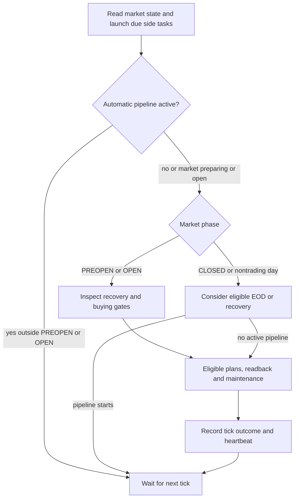
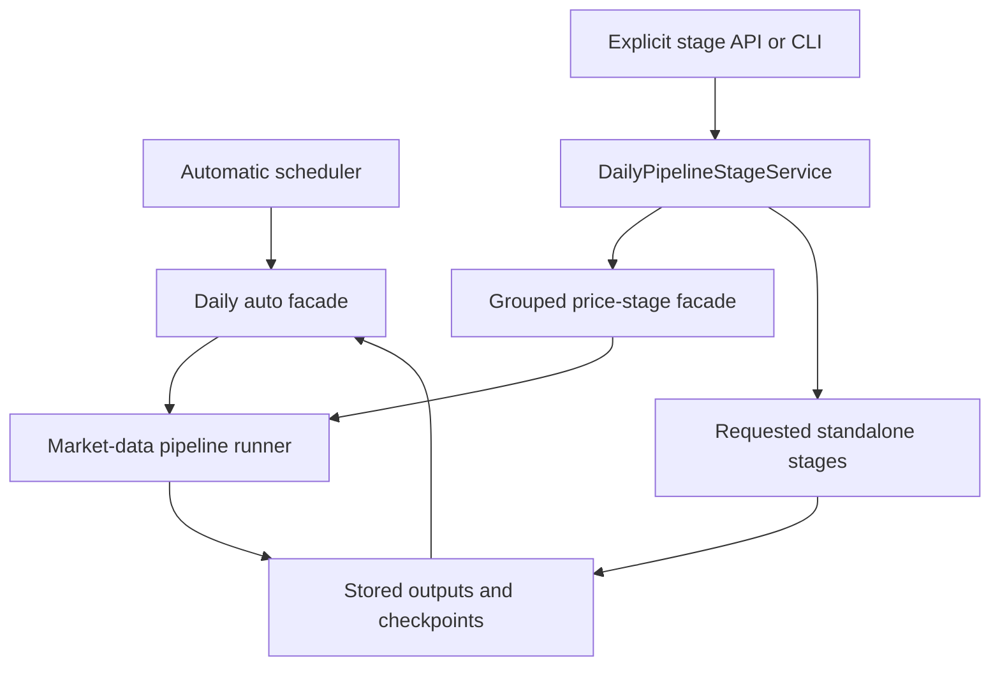
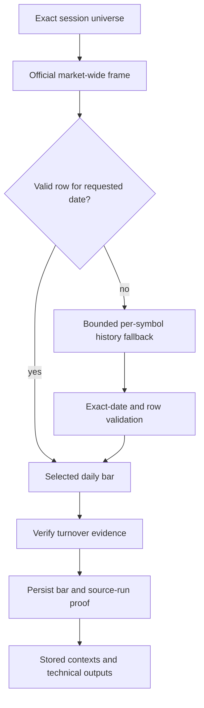
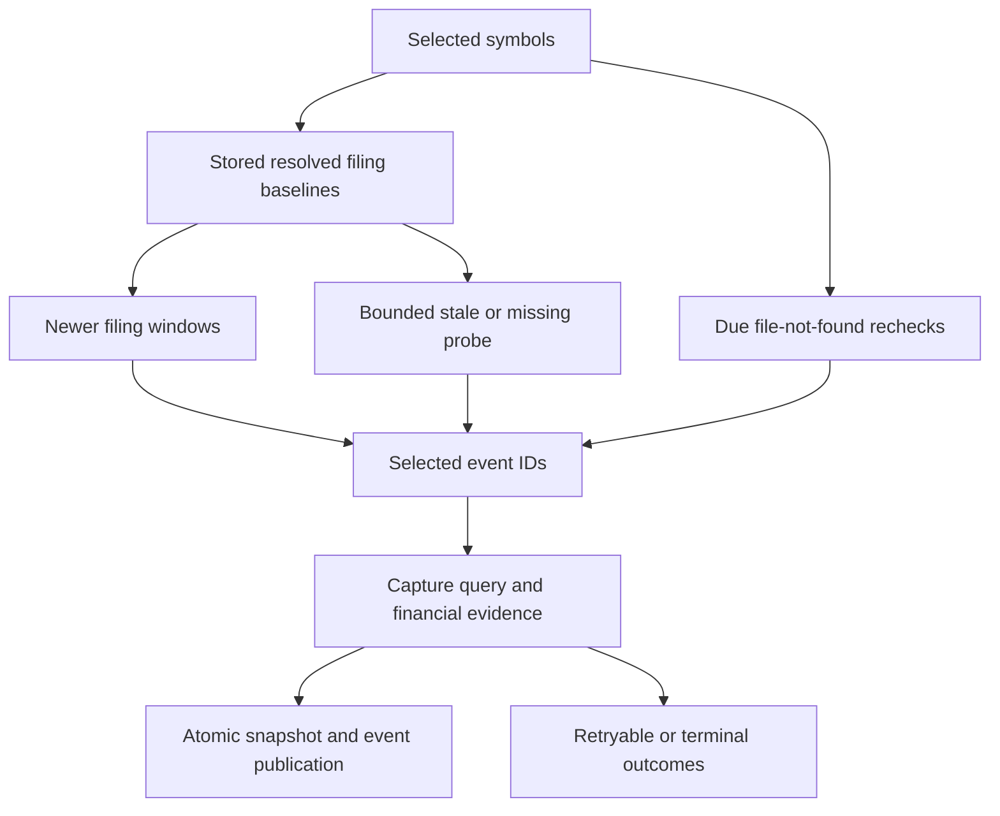
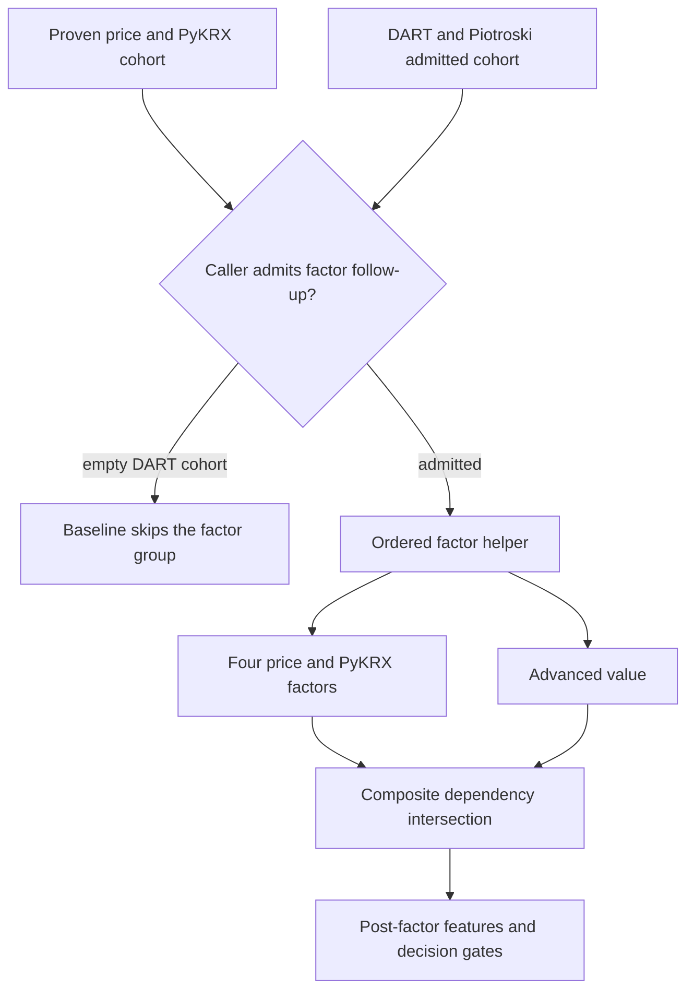
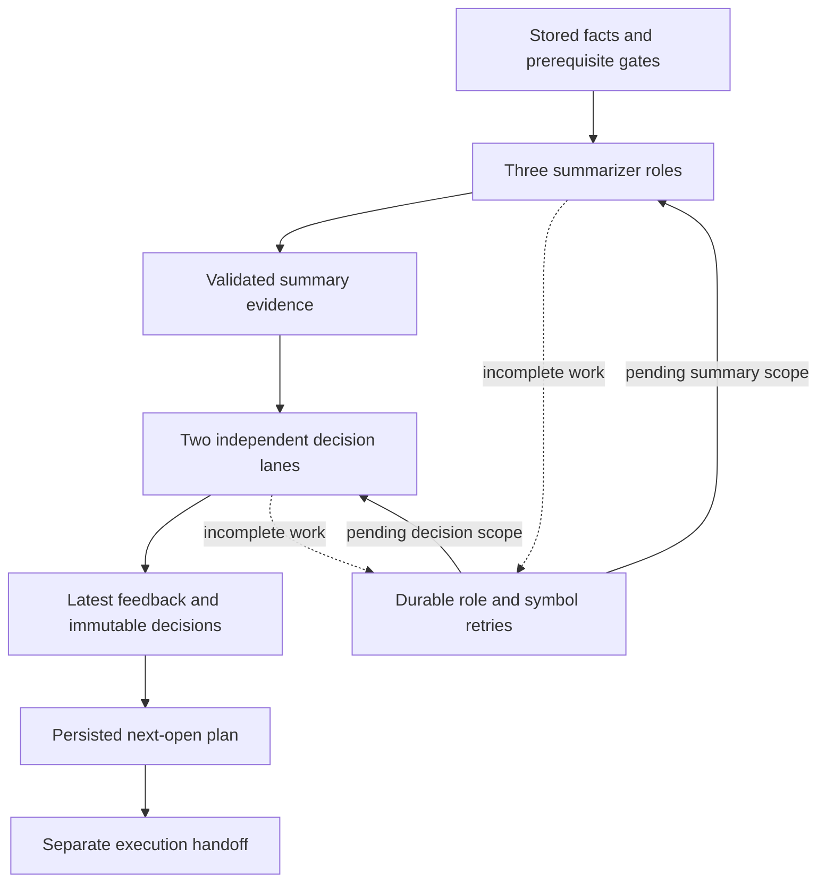
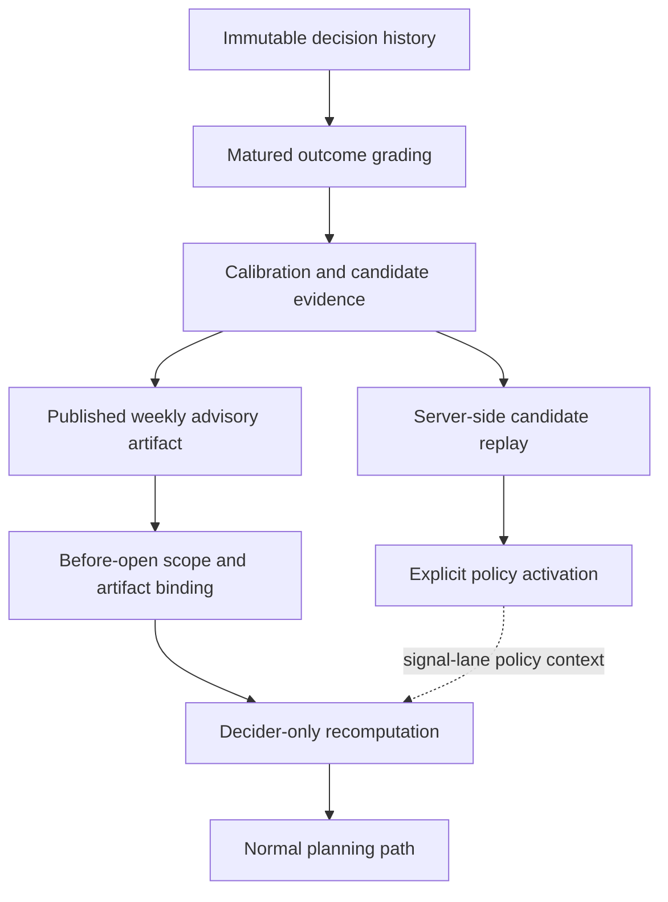
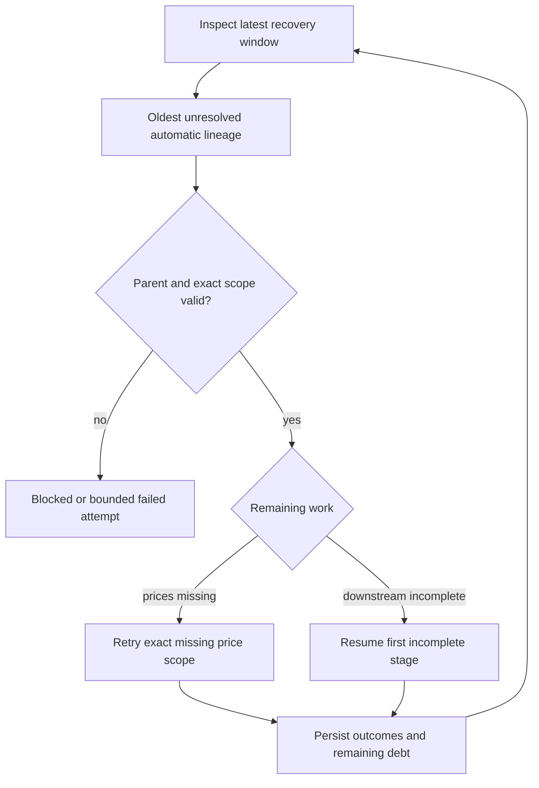
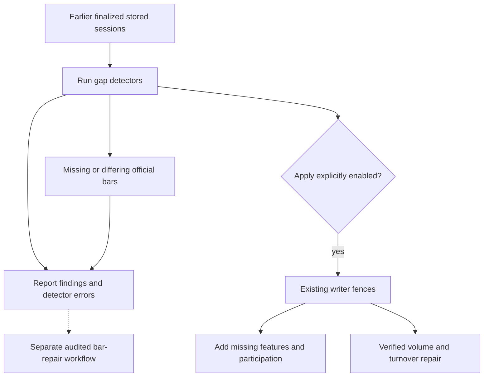
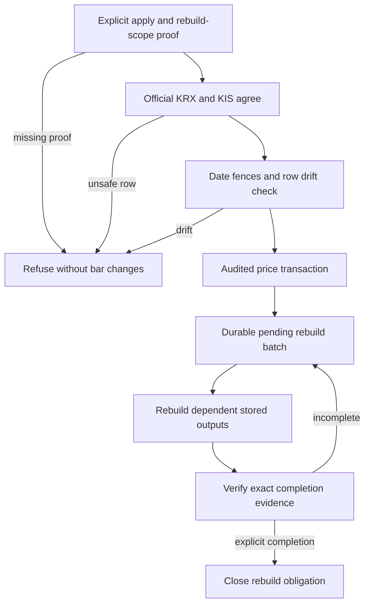

# Daily processing and recovery

This catalog describes the implementation at [`2322295cdda099`](https://github.com/kiseyno-AI/kai-trading-core/tree/2322295cdda099367e812b09d4187858434e49fc), including the changes already merged by the start of the 2026-11-08 audit. It describes source defaults and persisted boundaries; it does not assert which options are enabled in a deployed process.

**Audit status:** the [audit checkpoint](../audit/2026-11-08-checkpoint.md) records confirmed defects, locally tested patches, pending patches, and unfinished coverage. This documentation commit does not contain those local application patches. Known baseline limitations are called out below.

KRX times are Korea Standard Time. Solid diagram arrows show calls, progression, or the dependency stated in the caption. A dependency graph does not imply that its stages run concurrently.

## 1. Daily schedule and ownership

| Phase or window | Implemented work | Admission and ownership |
| --- | --- | --- |
| Every runner tick | Read market state; perform eligible agent-session cleanup; launch due news and overtime-ranking work | The runner maintains single-flight tasks and records heartbeat, last success, and last error. |
| PREOPEN | Inspect automatic recovery debt; refresh market/master evidence; refresh and dispatch next-open plans when eligible | The immediately previous session may start point-in-time recovery before the open. Other older debt blocks new buying work. The dispatch due predicate starts at **08:00**. |
| **08:50 to before 15:31** | Open-drive market-snapshot refresh buckets | Default interval is **300 seconds**; the configured refresh interval must fit within the allowed evidence age. |
| OPEN | Refresh master and live-market evidence; update delegated authority/plans; read back Exec; perform eligible retained Core reconciliation/protection work | Recovery debt suppresses new buying work. Exec owns the lifecycle of delegated orders independently. |
| **09:30 to before 15:00** | Optional gap detection and additive repairs of earlier stored sessions | Both scheduling and writes are disabled by default. The default **900-second** budget limits starting another fixer; it does not cancel an already running operation. |
| **17:45–18:30** | Independently scheduled KIS overtime-ranking capture | Launched before the active-pipeline short circuit, so an EOD recovery task does not starve it. |
| CLOSED after the configured buffer | Consider automatic EOD for the selected session | With a **15:30** session close and the default **280-minute** buffer, eligibility is **20:10**: 15:30 + 4 hours 40 minutes. |
| WEEKEND or HOLIDAY | Select the latest valid trading session and inspect recovery | A terminal session is not recollected simply because the runner polls again. |

The ordinary runner poll defaults to **60 seconds**. These are implementation settings, not a cron promise: market-state checks, enabled flags, active tasks, preflight backoff, and durable completion proof can defer work. The EOD scheduler uses the market state's session-close timestamp; the separate same-day finalized-write guard uses the regular KRX 15:30 close plus the configured buffer.

**Source:** [runner and dispatch predicate](https://github.com/kiseyno-AI/kai-trading-core/blob/2322295cdda099367e812b09d4187858434e49fc/apps/api/app/eod/runner.py), [automatic scheduler](https://github.com/kiseyno-AI/kai-trading-core/blob/2322295cdda099367e812b09d4187858434e49fc/apps/api/app/eod/auto_pykrx.py), [settings](https://github.com/kiseyno-AI/kai-trading-core/blob/2322295cdda099367e812b09d4187858434e49fc/apps/api/app/core/settings.py), [finalized-write guard](https://github.com/kiseyno-AI/kai-trading-core/blob/2322295cdda099367e812b09d4187858434e49fc/apps/api/app/eod/finality.py).

### How one runner tick branches

The graph shows the ordinary progression. A critical-step exception is caught at the outer tick boundary and records a failed tick. At this baseline, an OPEN master/snapshot/plan-refresh failure can therefore skip later Core maintenance in that tick. The continuity issue is a **review lead awaiting a regression and fix**, not a completed improvement. The recovery-inspection exception has a narrower handler that blocks new buys without immediately aborting the rest of the tick.

**Source:** [`EODBackgroundRunner._run_loop` and `_run_buy_authority_critical_step`](https://github.com/kiseyno-AI/kai-trading-core/blob/2322295cdda099367e812b09d4187858434e49fc/apps/api/app/eod/runner.py).

## 2. Automatic and explicit entry points

The automatic facade selects `daily_auto` and enables its follow-up chain. An explicit grouped stage run selects `daily_stage_run` and disables hidden fundamentals follow-ups in the shared price runner; `DailyPipelineStageService` owns the remaining requested stages. The service orders requested stages canonically. It does not automatically supply every omitted dependency: the admission checks must establish the necessary stored evidence.

| Entry point | Primary responsibility | Persisted scope |
| --- | --- | --- |
| `AutoPykrxEODScheduler._schedule_pipeline_if_due` | Select the session or recovery target and launch one task | Selected market date and original recovery EOD run identity |
| `run_daily_pipeline_if_due` | Automatic daily orchestration and resumable follow-up | Exact membership, source run, stage outcomes, and downstream debt |
| `DailyPipelineStageService.run` | Explicit ordered stage execution and recovery | Requested canonical stages plus validated parent/scope evidence |
| Historical backfill | Bounded historical price/context work | Historical membership and date-bounded inputs; narrower stage set |

**Source:** [automatic scheduler](https://github.com/kiseyno-AI/kai-trading-core/blob/2322295cdda099367e812b09d4187858434e49fc/apps/api/app/eod/auto_pykrx.py), [backfill/daily facades](https://github.com/kiseyno-AI/kai-trading-core/blob/2322295cdda099367e812b09d4187858434e49fc/apps/api/app/eod/pykrx_backfill.py), [stage service and stage definitions](https://github.com/kiseyno-AI/kai-trading-core/blob/2322295cdda099367e812b09d4187858434e49fc/apps/api/app/eod/daily_pipeline_stages.py), [historical stage boundary](https://github.com/kiseyno-AI/kai-trading-core/blob/2322295cdda099367e812b09d4187858434e49fc/apps/api/app/eod/pykrx_pipeline_runner.py).

## 3. Price ingestion and daily outputs

The official market-wide row is preferred. Invalid or unavailable rows enter the bounded fallback/recovery path and still need the requested date. A historical identity may be inserted inactive for foreign-key integrity; historical ingestion must not redefine today's active universe. Point-in-time recovery uses a frozen validated membership manifest.

| Stage family | Input boundary | Durable output |
| --- | --- | --- |
| Price collection | Exact-date membership and validated provider bars | `daily_price_bars` and collection-run provenance |
| PyKRX enrichment | Same-date symbol/market evidence | `daily_pykrx_enrichment_rows` |
| Technical/context work | Stored bars bounded by the target date | `daily_price_contexts`, `daily_technical_snapshots` |
| Action summaries | Technical snapshots and stored context | `daily_action_summaries` |
| Trending ranks | Exact-date stored price history | `daily_trending_ranks` |
| Market-risk screening | KIS status evidence and stored-volume dormancy evidence | `daily_market_risk_snapshots`, `daily_market_risk_filter_results` |

A successfully persisted screening rejection is still a successful computation. It is not permission to include that symbol in a later decision or buy. Subsequent cohorts use exact identities and their admission proof, not just row counts.

**Source:** [price selection and pipeline](https://github.com/kiseyno-AI/kai-trading-core/blob/2322295cdda099367e812b09d4187858434e49fc/apps/api/app/eod/pykrx_pipeline_runner.py), [stage definitions](https://github.com/kiseyno-AI/kai-trading-core/blob/2322295cdda099367e812b09d4187858434e49fc/apps/api/app/eod/daily_pipeline_stages.py), [symbol identity repository](https://github.com/kiseyno-AI/kai-trading-core/blob/2322295cdda099367e812b09d4187858434e49fc/apps/api/app/repositories/symbol_repository.py), [market-risk filter](https://github.com/kiseyno-AI/kai-trading-core/blob/2322295cdda099367e812b09d4187858434e49fc/apps/api/app/signals/market_risk_filter.py), [market-data persistence](https://github.com/kiseyno-AI/kai-trading-core/blob/2322295cdda099367e812b09d4187858434e49fc/apps/api/app/market_data_store.py).

## 4. DART refresh and bounded backlog work

The normal path searches newer financial-report disclosure windows for each symbol. Bounded rotation admits stale/missing symbols for catch-up. The stale-drain default is **100** symbols. A file-not-found `[014]` event may be reconsidered when its last attempt is older than **three days** and it has fewer than **three** total attempts. Daily rechecks are capped at **20**, further bounded by remaining capture capacity.

The ordinary capture timeout defaults to **60 seconds**; annual-report audit/document work has a separate **240-second** timeout. Consolidated-statement `[013]` may fall back to separate statements. Terminal no-data/mapping outcomes are distinct from retryable capture failures. Snapshot replacement and successful event publication share the repository transaction.

**Known baseline defect:** the daily path selects old due `[014]` IDs, but the subsequent capture query reapplies the newer-filings lower receipt bound and can exclude those IDs. A local regression reproduced zero captures; its fix passed focused tests but is **not included in this documentation commit**. See DATA-2 in the [checkpoint](../audit/2026-11-08-checkpoint.md).

**Source:** [capture service](https://github.com/kiseyno-AI/kai-trading-core/blob/2322295cdda099367e812b09d4187858434e49fc/apps/api/app/dart/fundamentals_capture_service.py), [recheck eligibility, candidate query, and atomic publication](https://github.com/kiseyno-AI/kai-trading-core/blob/2322295cdda099367e812b09d4187858434e49fc/apps/api/app/dart/fundamentals_store.py), [timeout/probe settings](https://github.com/kiseyno-AI/kai-trading-core/blob/2322295cdda099367e812b09d4187858434e49fc/apps/api/app/core/settings.py).

## 5. Factor cohorts and downstream decision eligibility

### Baseline factor admission

The helper has separate price and DART/Piotroski cohorts. The merged cohort change lets momentum, value, low-risk, and beta use the proven price/PyKRX cohort when the helper is reached. **At this baseline, the caller can still skip the entire group when the DART/Piotroski cohort is empty.** The local audit patch addresses that boundary; it is not present in this remote documentation snapshot.

The graph isolates composite admission; unified value and quality are listed below without an edge into composite. Factors execute in this order:

| Order | Stage | Cohort/dependency boundary |
| ---: | --- | --- |
| 1 | Momentum | Proven price/PyKRX cohort |
| 2 | Value | Proven price/PyKRX cohort |
| 3 | Low-risk | Proven price/PyKRX cohort |
| 4 | Beta | Proven price/PyKRX cohort |
| 5 | Advanced value | DART/Piotroski-admitted cohort |
| 6 | Unified value | DART/Piotroski-admitted cohort |
| 7 | Quality | DART/Piotroski-admitted cohort |
| 8 | Composite | DART/Piotroski-admitted symbols that succeeded in momentum, value, low-risk, beta, and advanced value |

Component stages are siblings: one component's per-symbol failure does not automatically suppress an independent component attempt. Composite does not consume unified value or quality merely because they appear earlier in the ordered list. Ranking remains bound to the full exact membership even when the write/admitted subset is smaller.

Atomic publication proof binds stage, date, exact scope, and actual successful identities. Signal-feature and decision admission have their own evidence requirements; computing an independent price factor does not grant a symbol decision authority. Stored-only repair cannot manufacture historical live quote/ranking evidence.

**Source:** [`FACTOR_FOLLOWUP_STAGE_ORDER`, `FACTOR_FOLLOWUP_STAGE_DEPENDENCIES`, `_run_daily_factor_followup`, and caller gates](https://github.com/kiseyno-AI/kai-trading-core/blob/2322295cdda099367e812b09d4187858434e49fc/apps/api/app/eod/pykrx_pipeline_runner.py), [scope outcomes and atomic finalization](https://github.com/kiseyno-AI/kai-trading-core/blob/2322295cdda099367e812b09d4187858434e49fc/apps/api/app/eod/scope_outcomes.py), [signal features](https://github.com/kiseyno-AI/kai-trading-core/blob/2322295cdda099367e812b09d4187858434e49fc/apps/api/app/signals/daily_signal_features.py), [stored-only feature repair](https://github.com/kiseyno-AI/kai-trading-core/blob/2322295cdda099367e812b09d4187858434e49fc/apps/api/app/eod/stored_signal_feature_backfill.py).

## 6. Summaries, decisions, planning, and learning

### Daily decision flow and durable retries

The `agent_feedback_summaries` stage selects all three summarizers. The stage named `signal_decider` selects **both** decision lanes despite its singular name. Their configured dispatch order is separate from their decision authority: the lanes do not become one strategy merely because they share summary inputs.

| Role | Responsibility |
| --- | --- |
| `eod-summarizer` | Per-symbol completeness, freshness, anomalies, and data gaps |
| `technical-summarizer` | Technical setup, momentum, support/resistance, and invalidation evidence |
| `fundamental-summarizer` | Business quality, balance-sheet and cash-flow evidence with source-aware interpretation |
| `short-term-decider` | Tactical `scalp_buy_candidate`, `watch_for_trigger`, `avoid_chase`, `wait`, or `reject` classification |
| `signal-decider` | Independent longer-horizon `buy`, `wait`, or `reject` decision support |

Dispatch calls OpenClaw's `/v1/responses` with the requested `submit_agent_feedback_batch` response envelope and its documented canonical JSON-text fallback. Each batch session is single-shot; the durable outer retry service owns retries.

The parent normalizes prerequisites and scope authority, then dispatches role/symbol chunks with the parent run ID, fixed knowledge cutoff, and summary-run identity. It resolves reuse before dispatch; queued child work receives `reuse_existing=False` so the child cannot reinterpret that parent decision. Ownership is checked before child dispatch. A retry continues identified work; it does not grant permission to rerun every role or change the cutoff.

Latest feedback is keyed by date, symbol, and agent. Eligible decision feedback creates a snapshot in the same transaction. Snapshot insertion reuses a matching content fingerprint rather than overwriting decision history. The mutable latest-feedback view and immutable decision history serve different purposes.

**Source:** [stage selection and dispatch](https://github.com/kiseyno-AI/kai-trading-core/blob/2322295cdda099367e812b09d4187858434e49fc/apps/api/app/eod/daily_pipeline_stages.py), [`DISPATCH_SPECS`, payloads, and `dispatch_batch`](https://github.com/kiseyno-AI/kai-trading-core/blob/2322295cdda099367e812b09d4187858434e49fc/apps/api/app/agent_context/orchestrator.py), [retry admission and child dispatch](https://github.com/kiseyno-AI/kai-trading-core/blob/2322295cdda099367e812b09d4187858434e49fc/apps/api/app/agent_context/retry_service.py), [feedback persistence](https://github.com/kiseyno-AI/kai-trading-core/blob/2322295cdda099367e812b09d4187858434e49fc/apps/api/app/agent_context/feedback_service.py), [decision snapshots](https://github.com/kiseyno-AI/kai-trading-core/blob/2322295cdda099367e812b09d4187858434e49fc/apps/api/app/agent_context/signal_decider_loop_service.py).

### Planning and execution handoff

The daily next-open stage checks its action window and completion evidence before `refresh_plan_items`, using `daily_pipeline_post_decider`. It materializes plan rows; broker submission is separate.

PREOPEN/OPEN dispatch checks current controls and evidence. Core persists dispatch intent, registers the plan, checks the exact ACK identity, and follows the applicable activation contract. It later reads plans, orders, executions, and positions using those accepted identities. Core-local next-open BUY candidates remain empty; disabled delegation does not enable a local next-open buying fallback.

**Source:** [daily planning stage](https://github.com/kiseyno-AI/kai-trading-core/blob/2322295cdda099367e812b09d4187858434e49fc/apps/api/app/eod/daily_pipeline_stages.py), [next-open service](https://github.com/kiseyno-AI/kai-trading-core/blob/2322295cdda099367e812b09d4187858434e49fc/apps/api/app/orders/next_open_execution.py), [handoff and readback](https://github.com/kiseyno-AI/kai-trading-core/blob/2322295cdda099367e812b09d4187858434e49fc/apps/api/app/orders/exec_integration.py), [runner dispatch](https://github.com/kiseyno-AI/kai-trading-core/blob/2322295cdda099367e812b09d4187858434e49fc/apps/api/app/eod/runner.py).

### Evaluation and weekly context are separate transitions

Historical grading is explicitly outside the default execution-critical daily chain. Its maintenance entry point accepts idle market states, waits until **22:30 KST** on a closed trading day, and records completion for the latest valid trading date. The existence of a command/installer does not establish that a scheduler is installed.

Weekly publication builds a calibration report from a maturity-buffered historical window, validates its manifest, determines eligibility, and stores a versioned artifact. Its context is advisory. Publication can produce an ineligible artifact, and later reads check integrity/eligibility before use. Both decision lanes receive published performance criteria; only `signal-decider` additionally receives the active database policy.

Weekly rebind verifies source/target dates, artifact identity/hash, completed-summary proof, role-specific symbols, and the exact knowledge cutoff. Its idempotency key binds that evidence. It requests a decider-only recomputation with `force_recompute=True`, `reuse_existing=True`, three cycles, and an outer batch size of 20; an identical completed request is a no-op. Coordination does not submit orders.

The production retry service independently rejects work after the target's safe before-open window before invoking the coordinator callback. The audit found an inconsistent callback when tested with an injected adapter and a missing import in a fallback adapter without `list_runs`. A production bypass of the independent date guard has not been demonstrated.

Policy activation is a different operation. It needs a named actor and replay evidence, reconstructs and runs server-side replay, validates promotion proof, then changes the active policy. Publishing a weekly artifact does not activate a policy.

The signal lab and optional improvement script form another path: stored-data research → findings → proposed guarded branch/PR. Apply mode is explicit, and the improvement runner contains no merge step. Its reproduced calculation/guard defects remain listed in the audit checkpoint.

**Source:** [evaluation maintenance](https://github.com/kiseyno-AI/kai-trading-core/blob/2322295cdda099367e812b09d4187858434e49fc/apps/api/app/agent_context/evaluation_refresh.py), [weekly publication and artifact reads](https://github.com/kiseyno-AI/kai-trading-core/blob/2322295cdda099367e812b09d4187858434e49fc/apps/api/app/agent_context/signal_decider_weekly_learning_service.py), [lane policy context](https://github.com/kiseyno-AI/kai-trading-core/blob/2322295cdda099367e812b09d4187858434e49fc/apps/api/app/agent_context/orchestrator.py), [weekly rebind](https://github.com/kiseyno-AI/kai-trading-core/blob/2322295cdda099367e812b09d4187858434e49fc/apps/api/app/agent_context/weekly_policy_rebind_service.py), [independent retry session guard](https://github.com/kiseyno-AI/kai-trading-core/blob/2322295cdda099367e812b09d4187858434e49fc/apps/api/app/agent_context/retry_service.py), [policy activation](https://github.com/kiseyno-AI/kai-trading-core/blob/2322295cdda099367e812b09d4187858434e49fc/apps/api/app/agent_context/signal_decider_loop_service.py), [research lab](https://github.com/kiseyno-AI/kai-trading-core/blob/2322295cdda099367e812b09d4187858434e49fc/apps/api/app/analytics/signal_lab.py), [optional local launcher](https://github.com/kiseyno-AI/kai-trading-core/blob/2322295cdda099367e812b09d4187858434e49fc/scripts/run_agent_improvement_local.sh), [improvement runner](https://github.com/kiseyno-AI/kai-trading-core/blob/2322295cdda099367e812b09d4187858434e49fc/scripts/agent_improvement_run.py).

## 7. Recovery preserves exact lineage

The scheduler inspects the latest **five KRX sessions** and carries the selected EOD run ID together with its date. A later manual row cannot silently replace the intended automatic lineage. Recovery preserves unresolved per-symbol debt and can resume downstream stages without recollecting complete prices when their proof is usable.

During PREOPEN, only the immediately previous session has the scheduler's special older-debt recovery admission. Other older debt blocks buying work. OPEN does not start that recovery. Historical work uses bounded evidence and skips current-only capture paths; the previous-session PREOPEN KIS market-risk path has an explicit exception.

A periodic heartbeat protects durable stage ownership during long work. Confirmed ownership loss stops progression. A transient heartbeat storage error alone is not positive proof that another owner acquired the run; checkpoint and finalization gates still apply.

**Source:** [recovery window and PREOPEN exception](https://github.com/kiseyno-AI/kai-trading-core/blob/2322295cdda099367e812b09d4187858434e49fc/apps/api/app/eod/auto_pykrx.py), [recovery target repository](https://github.com/kiseyno-AI/kai-trading-core/blob/2322295cdda099367e812b09d4187858434e49fc/apps/api/app/repositories/eod_run_repository.py), [daily recovery facade](https://github.com/kiseyno-AI/kai-trading-core/blob/2322295cdda099367e812b09d4187858434e49fc/apps/api/app/eod/pykrx_backfill.py), [current-only stage boundary](https://github.com/kiseyno-AI/kai-trading-core/blob/2322295cdda099367e812b09d4187858434e49fc/apps/api/app/eod/daily_pipeline_tracking.py), [pipeline recovery/heartbeat checks](https://github.com/kiseyno-AI/kai-trading-core/blob/2322295cdda099367e812b09d4187858434e49fc/apps/api/app/eod/pykrx_pipeline_runner.py), [heartbeat implementation](https://github.com/kiseyno-AI/kai-trading-core/blob/2322295cdda099367e812b09d4187858434e49fc/apps/api/app/eod/stage_heartbeat.py).

## 8. Daytime gap detection and additive repair

The job is disabled by default, and enabling its schedule still leaves writes disabled until `DATA_GAP_FILL_APPLY` is enabled. It selects earlier dates from stored bar sessions and validates finality. An entirely absent calendar session is outside the discovery scope of a loader based only on existing bars.

Tier A repairs run oldest-first in feature → participation → turnover order. Feature backfill adds missing symbol/date rows without overwriting existing rows. Participation rebuild uses stored features. Turnover repair requires exact provider OHLC agreement and nondecreasing liquidity; explicit partial-verified mode leaves unverified rows unchanged.

Tier B is report-only and requires a separate audited bar repair/restatement workflow. Failures, blocked/no-progress cooldowns, and detector errors are separate outcomes. The budget prevents another fixer from starting; it is not an interrupt deadline.

**Known baseline defects:** unrelated feature rows can hide an actually missing symbol because the detector compares totals; the singleton's cached Tier-B comparison can remain stale after a repair. Both were reproduced and fixed locally with passing focused tests, but the source changes are not in this documentation commit.

**Source:** [gap scheduler, detectors, and comparison cache](https://github.com/kiseyno-AI/kai-trading-core/blob/2322295cdda099367e812b09d4187858434e49fc/apps/api/app/eod/data_gap_fill.py), [additive feature backfill](https://github.com/kiseyno-AI/kai-trading-core/blob/2322295cdda099367e812b09d4187858434e49fc/apps/api/app/eod/stored_signal_feature_backfill.py), [turnover repair](https://github.com/kiseyno-AI/kai-trading-core/blob/2322295cdda099367e812b09d4187858434e49fc/apps/api/app/eod/turnover_repair.py), [transactional turnover write](https://github.com/kiseyno-AI/kai-trading-core/blob/2322295cdda099367e812b09d4187858434e49fc/apps/api/app/market_data_store.py).

## 9. Official restatement and rebuild obligations

Restatement requires complete official reference frames and stored membership proof for the rebuild dates. KIS and the official reference must agree on a changed row; the close-change guard must also accept it. A row already matching the official reference is left unchanged.

The writer compares locked rows with the earlier fetch snapshot. One transaction creates the pending batch, immutable before/after audit, expected-old-value price changes, readback verification, and frozen rebuild evidence. Exceptions roll back that transaction.

**Known baseline race:** downstream dates are discovered before the writer locks them, and the default global admission is shared. A newly created downstream date can escape the supplied rebuild scope. The proposed local change adds exclusive admission and an in-transaction scope recheck; its post-fix tests did not complete before the execution environment became unavailable. The diagram above therefore describes the baseline lock boundary.

Rebuild covers the affected and later dependent stored dates. Verification alone does not close the pending batch: completion is an explicit action requiring all proof. The startup guard refuses to start Core while pending batches exist; it does not stop an already running process.

**Source:** [official reference and rebuild proof](https://github.com/kiseyno-AI/kai-trading-core/blob/2322295cdda099367e812b09d4187858434e49fc/apps/api/app/eod/official_bar_restatement.py), [shared repair writer](https://github.com/kiseyno-AI/kai-trading-core/blob/2322295cdda099367e812b09d4187858434e49fc/apps/api/app/eod/kis_final_bar_repair.py), [writer admission locks](https://github.com/kiseyno-AI/kai-trading-core/blob/2322295cdda099367e812b09d4187858434e49fc/apps/api/app/repositories/eod_run_repository.py), [pending rebuild verification and closeout](https://github.com/kiseyno-AI/kai-trading-core/blob/2322295cdda099367e812b09d4187858434e49fc/apps/api/app/eod/price_bar_repair_state.py), [startup guard](https://github.com/kiseyno-AI/kai-trading-core/blob/2322295cdda099367e812b09d4187858434e49fc/apps/api/app/main.py).

## 10. What to inspect when the day does not advance

| Question | Evidence to inspect |
| --- | --- |
| Which loop or stage is active? | Runner snapshot, `daily_pipeline_runs`, `daily_pipeline_stage_runs`, heartbeat, and source-run links |
| Which symbols advanced? | Exact selected/success/retry/terminal manifests and atomic finalization evidence |
| Why are factor rows fewer than price rows? | Price/DART cohorts, stage-specific successes, ranking membership, and the diagnostic daily coverage audit |
| Why did DART defer a symbol? | Probe/stale-drain selection, exact event status, attempt history, capture limits, and receipt-window bounds |
| Why did a gap fixer not write? | Apply flag, finality, writer fences, cooldown, remaining budget, detector error, and no-progress outcome |
| Why did buying stop while data work continued? | Recovery disposition, critical-step result, current market authority, plan freshness, and Exec ACK/fence state |
| Can a price-repair batch close? | Frozen membership, source fingerprints, exact rebuild dates, immutable audit, and every required completion proof |

Counts, computation success, screening admission, valid decisions, and live order authority are different facts. A completed run label does not replace their identities or evidence.

**Source:** [runner diagnostics](https://github.com/kiseyno-AI/kai-trading-core/blob/2322295cdda099367e812b09d4187858434e49fc/apps/api/app/eod/runner.py), [daily pipeline state](https://github.com/kiseyno-AI/kai-trading-core/blob/2322295cdda099367e812b09d4187858434e49fc/apps/api/app/eod/daily_pipeline_state.py), [scope proofs](https://github.com/kiseyno-AI/kai-trading-core/blob/2322295cdda099367e812b09d4187858434e49fc/apps/api/app/eod/scope_outcomes.py), [repair state](https://github.com/kiseyno-AI/kai-trading-core/blob/2322295cdda099367e812b09d4187858434e49fc/apps/api/app/eod/price_bar_repair_state.py), [execution integration](https://github.com/kiseyno-AI/kai-trading-core/blob/2322295cdda099367e812b09d4187858434e49fc/apps/api/app/orders/exec_integration.py).

## Documentation validation

This document was checked against the pinned source and the audit agents' cited call paths. Mermaid blocks use top-down flowcharts, quoted labels, and no external rendering service. The local rendering environment was unavailable at publication, so a visual render check is still pending. The audit checkpoint separates architectural documentation from unfinished source verification.
