# System and feature architecture

Source-verified English diagrams for `kai-trading-core`, based on [5a0ce6b4260d](https://github.com/kiseyno-AI/kai-trading-core/tree/5a0ce6b4260d47c7cc8177f67be5b29f1811f2c7) (2026-11-08).

Core is a FastAPI modular monolith: HTTP handlers, operator commands, and background jobs use domain services backed by PostgreSQL. OpenClaw supplies agent responses; the separate Exec service owns delegated broker execution. Each diagram below describes one responsibility or flow and links to the implementation that establishes its boundaries.

[Back to the main README](../../README.md#architecture-and-data-flow) · [API inventory](../API_BUILD_ORDER.md) · [Operations](../../RUNBOOK.md)

## Reading the diagrams

- Solid arrows show data dependencies or calls. Blue connectors identify external/API relationships.
- Dashed arrows show conditional or compatibility paths; individual notes identify the uninspected Exec-to-broker contract boundary.
- A two-ended connector combines a request with its response or later readback. It does not imply a callback API.
- Module, store, external, gate, and foundation tags distinguish responsibilities; boxes are not deployed servers.

- This is a source snapshot, not an inspection of running services, deployed settings, database contents, or live provider availability.
- OpenClaw and kai-trading-exec are external integration boundaries. Their internal implementations and deployment topology were not inspected.
- Graphify includes tests and migrations and may infer relationships. Only source-verified directions appear in the feature flow diagrams.
- Settings defaults describe the checked-in implementation; they do not establish which features are enabled in a deployment.

## Feature index

| Diagram | Responsibility |
| --- | --- |
| [System boundaries](#system) | Core collects market facts, builds decision evidence, and prepares execution plans. OpenClaw and Exec are external integration boundaries; their internal implementations are outside this repository review. |
| [Core layers and startup](#runtime) | HTTP requests and background jobs use domain services in one Python application. SQLAlchemy manages persistence; startup checks database and repair readiness before starting realtime and scheduled work. |
| [Korean symbols, favorites and scanners](#market-discovery) | Symbol search, stored daily rankings and realtime rankings use separate inputs. Realtime ranking results use an in-process TTL cache. |
| [Korean quotes and fallbacks](#quotes) | Market state and data availability select the response. If a live quote is unavailable, QuoteService checks a usable daily bar and then same-day quote caches. |
| [Market snapshots and FX](#market-fx) | KRX session state drives snapshot refreshes. KIS index and investor-flow observations are combined with optional USD/KRW data; FX also has a standalone read API. |
| [Korean EOD execution and recovery](#eod-orchestration) | The automatic scheduler enters PykrxBackfillService. The stage API enters DailyPipelineStageService directly; grouped price stages reuse the same PyKRX collection runner. |
| [Daily price collection priority](#eod-price) | For daily_auto and daily_stage_run, collection first tries the official market-wide frame cached by market and date. An unusable symbol row falls back to the per-symbol history endpoint. |
| [EOD derived data and factor inputs](#eod-derived) | Stored prices, PyKRX enrichment and DART fundamentals feed deterministic analysis. Signal features incorporate market-risk, Piotroski and factor results. |
| [DART incremental fundamentals](#dart) | Daily refresh scopes corporations and receipt dates, synchronizes disclosures, and captures eligible events. Snapshot rows and successful event status are published in one transaction. |
| [Gap filling and audited price repair](#data-repair) | Gap filling is opt-in and report-only unless apply is enabled. Manual price restatement has separate evidence gates; applied rewrites create pending batches that block startup until required rebuilds are verified and completed. |
| [External news and macro evidence](#external-evidence) | Symbol news, topic news and macro observations use separate collection and storage paths. Their actual consumers are shown independently from the generic external-context foundation. |
| [Per-symbol decision context](#context) | Stored price, technical, factor, financial, news and macro evidence is read for the requested symbol and market date. Coverage, provenance and signal envelopes accompany the agent payload. |
| [Three summaries, two decision lanes](#agents) | Each symbol needs all three specialist summaries before either decider can proceed. Short-term and signal decisions have independent objectives and consume the same required summary bundle. |
| [Response validation, retries and history](#feedback) | Retries preserve parent/child run identity and exact role/symbol scopes. Mutable latest feedback and immutable decision snapshots serve different persistence and audit purposes. |
| [KR plan registration, activation and readback](#execution) | Core validates decision evidence and persists a plan plus dispatch write-ahead state before registration. It stores the acknowledgement, requests activation separately, and reconciles scoped remote state. |
| [Direct domestic orders and reconciliation](#orders) | Direct buy, sell and amend routes are disabled by default. When explicitly enabled, they use the durable domestic KIS order service. Matched order notices and broker inquiries reconcile persisted order state. |
| [Compatibility auto-sell from linked positions](#auto-sell) | Sellable account quantities and linked entry tranches produce watch rows. Observed prices are checked against target and stop thresholds before a dry-run record or an internal compatibility sell submission. |
| [Execution, price and portfolio read models](#monitoring) | Core provides JSON and SSE for external operator clients. Account summaries, persisted Exec readback and WebSocket prices remain distinct read models with their own caches and refresh behavior. |
| [Account inquiries and broker operations](#operations) | Account queries expose summaries, positions and buying power. Broker operations provide local health metadata, authorized token operations, quote queries and intraday snapshot collection and inspection. |
| [Evaluation and weekly advisory feedback](#learning) | Stored decisions are evaluated against subsequent prices. Mature evaluation cohorts and eligible actual execution evidence feed an immutable weekly artifact whose criteria can inform later decisions. |
| [Candidate policy replay and activation](#policy) | Calibration candidates pass through explicit replay and activation. Before promoting a new candidate, the server reruns the replay and validates the submitted evidence. |
| [Read-only signal evaluation lab](#signal-lab) | Stored KRX bars, factor scores and timestamped agent observations form a shared evaluation panel. Pure scoring functions test rank evidence and non-overlapping top-k returns, then the CLI writes local research reports. |
| [Guarded weekly agent improvement](#agent-improvement) | An optional local schedule runs the signal lab and deterministic findings. Dry-run is the default; opt-in application can propose bounded decider calibration notes by pull request or open deduplicated code issues. |
| [US equity pipeline and execution boundary](#us-equities) | The US scheduler runs universe refresh, price screening, SEC screening, agent analysis and execution planning in order. This plan-service path currently produces previews only. |
| [Crypto quotes and analysis context](#crypto) | Crypto reads public Upbit quotations and derives deterministic analysis context. This module provides research and decision support without private-account access or order submission. |

<a id="system"></a>

## System boundaries

Core collects market facts, builds decision evidence, and prepares execution plans. OpenClaw and Exec are external integration boundaries; their internal implementations are outside this repository review.

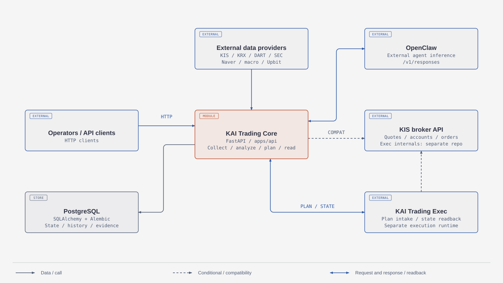

- Two-ended connectors combine requests with responses or later readback. OpenClaw returns a structured tool response; the connector does not represent an HTTP callback.
- The Core-to-KIS compatibility edge covers retained domestic broker paths. The direct buy, sell, and amend APIs are disabled by default; cancel remains available. Internal compatibility callers have separate controls.
- The dashed Exec-to-KIS edge describes the KIS/KRX/KRW execution contract expected by Core. The Exec broker implementation was not inspected.
- The diagram does not assert physical server locations, running processes, or deployed settings.

**Implementation evidence**

- [`apps/api/app/main.py`](https://github.com/kiseyno-AI/kai-trading-core/blob/5a0ce6b4260d47c7cc8177f67be5b29f1811f2c7/apps/api/app/main.py#L120-L252) — lifespan / router wiring
- [`apps/api/app/agent_context/orchestrator.py`](https://github.com/kiseyno-AI/kai-trading-core/blob/5a0ce6b4260d47c7cc8177f67be5b29f1811f2c7/apps/api/app/agent_context/orchestrator.py#L2926-L3035) — OpenClawAgentClient.dispatch_batch
- [`apps/api/app/orders/exec_integration.py`](https://github.com/kiseyno-AI/kai-trading-core/blob/5a0ce6b4260d47c7cc8177f67be5b29f1811f2c7/apps/api/app/orders/exec_integration.py)
- [`apps/api/app/orders/service.py`](https://github.com/kiseyno-AI/kai-trading-core/blob/5a0ce6b4260d47c7cc8177f67be5b29f1811f2c7/apps/api/app/orders/service.py)
- [`apps/api/app/orders/execution_handoff_contract.py`](https://github.com/kiseyno-AI/kai-trading-core/blob/5a0ce6b4260d47c7cc8177f67be5b29f1811f2c7/apps/api/app/orders/execution_handoff_contract.py#L389-L415) — KIS / KRX / KRW contract
- [`apps/api/app/api/routes_trading.py`](https://github.com/kiseyno-AI/kai-trading-core/blob/5a0ce6b4260d47c7cc8177f67be5b29f1811f2c7/apps/api/app/api/routes_trading.py#L126-L197) — default-off direct order dependency / buy and sell bindings
- [`apps/api/app/api/routes_trading.py`](https://github.com/kiseyno-AI/kai-trading-core/blob/5a0ce6b4260d47c7cc8177f67be5b29f1811f2c7/apps/api/app/api/routes_trading.py#L456-L484) — ungated cancel and gated amend

<a id="runtime"></a>

## Core layers and startup

HTTP requests and background jobs use domain services in one Python application. SQLAlchemy manages persistence; startup checks database and repair readiness before starting realtime and scheduled work.

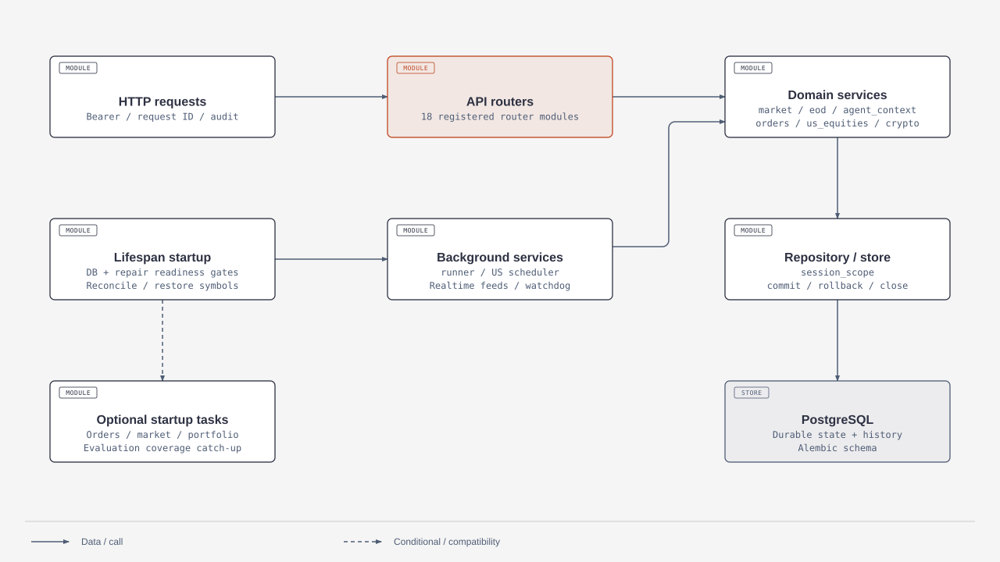

- Startup requires database readiness and no pending daily price-bar rebuilds before background or realtime services start.
- The lifespan reconciles interrupted pipeline/agent runs and restores tracked symbols. Optional maintenance and schedulers depend on settings.
- Redis, Parquet/DuckDB, and vectorbt remain roadmap items in the architecture summary; they are not current runtime components in this diagram.

**Implementation evidence**

- [`apps/api/app/main.py`](https://github.com/kiseyno-AI/kai-trading-core/blob/5a0ce6b4260d47c7cc8177f67be5b29f1811f2c7/apps/api/app/main.py#L85-L252) — lifespan / middleware / router registration
- [`apps/api/app/db.py`](https://github.com/kiseyno-AI/kai-trading-core/blob/5a0ce6b4260d47c7cc8177f67be5b29f1811f2c7/apps/api/app/db.py#L178-L219) — session_scope
- [`apps/api/app/db_models.py`](https://github.com/kiseyno-AI/kai-trading-core/blob/5a0ce6b4260d47c7cc8177f67be5b29f1811f2c7/apps/api/app/db_models.py)
- [`apps/api/app/core/settings.py`](https://github.com/kiseyno-AI/kai-trading-core/blob/5a0ce6b4260d47c7cc8177f67be5b29f1811f2c7/apps/api/app/core/settings.py)

<a id="market-discovery"></a>

## Korean symbols, favorites and scanners

Symbol search, stored daily rankings and realtime rankings use separate inputs. Realtime ranking results use an in-process TTL cache.

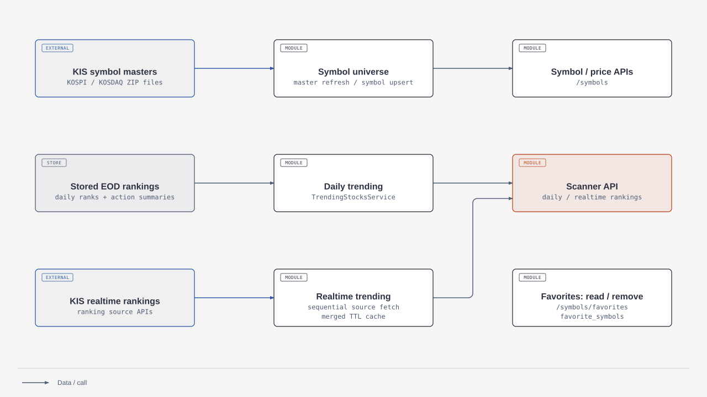

- Favorites are a separate stored list with read and delete routes. The diagram does not imply that scanner results populate that list.
- Daily trending reads persisted ranks and action summaries. Realtime trending fetches KIS sources sequentially, then merges and caches the results.
- Symbol search uses downloaded master records; historical price queries read stored daily bars. The grouped symbol API node combines these two read paths.

**HTTP coverage:** `/symbols`, `/symbols/favorites`, `/scanner`.

**Implementation evidence**

- [`apps/api/app/eod/master.py`](https://github.com/kiseyno-AI/kai-trading-core/blob/5a0ce6b4260d47c7cc8177f67be5b29f1811f2c7/apps/api/app/eod/master.py#L207-L249) — refresh_master_if_due / get_master_symbols
- [`apps/api/app/api/routes_symbols.py`](https://github.com/kiseyno-AI/kai-trading-core/blob/5a0ce6b4260d47c7cc8177f67be5b29f1811f2c7/apps/api/app/api/routes_symbols.py#L12-L67) — search_symbols / read_symbol_price_bars
- [`apps/api/app/scanner/trending.py`](https://github.com/kiseyno-AI/kai-trading-core/blob/5a0ce6b4260d47c7cc8177f67be5b29f1811f2c7/apps/api/app/scanner/trending.py#L48-L121) — TrendingStocksService.get_trending_stocks
- [`apps/api/app/scanner/realtime_trending.py`](https://github.com/kiseyno-AI/kai-trading-core/blob/5a0ce6b4260d47c7cc8177f67be5b29f1811f2c7/apps/api/app/scanner/realtime_trending.py#L307-L370) — RealtimeTrendingService.get_realtime_trending
- [`apps/api/app/api/routes_favorite_symbols.py`](https://github.com/kiseyno-AI/kai-trading-core/blob/5a0ce6b4260d47c7cc8177f67be5b29f1811f2c7/apps/api/app/api/routes_favorite_symbols.py#L16-L40) — get_favorite_symbols / delete_favorite_symbol

<a id="quotes"></a>

## Korean quotes and fallbacks

Market state and data availability select the response. If a live quote is unavailable, QuoteService checks a usable daily bar and then same-day quote caches.

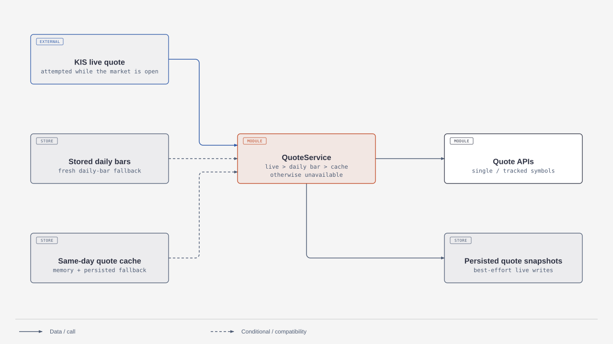

- The inputs show fallback priority, not concurrent provider calls. Daily-bar freshness is checked against the current market date and session state.
- The final cache fallback checks both the in-memory quote cache and the persisted current quote. Both must have a same-day timestamp.
- Responses expose source, fallback and is_live. The realtime WebSocket path appears in the monitoring diagram.

**HTTP coverage:** `/quotes`.

**Implementation evidence**

- [`apps/api/app/quotes/service.py`](https://github.com/kiseyno-AI/kai-trading-core/blob/5a0ce6b4260d47c7cc8177f67be5b29f1811f2c7/apps/api/app/quotes/service.py#L232-L296) — QuoteService.get_quote / get_tracked_quotes
- [`apps/api/app/quotes/service.py`](https://github.com/kiseyno-AI/kai-trading-core/blob/5a0ce6b4260d47c7cc8177f67be5b29f1811f2c7/apps/api/app/quotes/service.py#L123-L230) — same-day cache and daily-bar fallback
- [`apps/api/app/market_data_store.py`](https://github.com/kiseyno-AI/kai-trading-core/blob/5a0ce6b4260d47c7cc8177f67be5b29f1811f2c7/apps/api/app/market_data_store.py#L514-L582) — persist_quote_snapshot
- [`apps/api/app/api/routes_quotes.py`](https://github.com/kiseyno-AI/kai-trading-core/blob/5a0ce6b4260d47c7cc8177f67be5b29f1811f2c7/apps/api/app/api/routes_quotes.py#L15-L58) — quote and realtime read routes

<a id="market-fx"></a>

## Market snapshots and FX

KRX session state drives snapshot refreshes. KIS index and investor-flow observations are combined with optional USD/KRW data; FX also has a standalone read API.

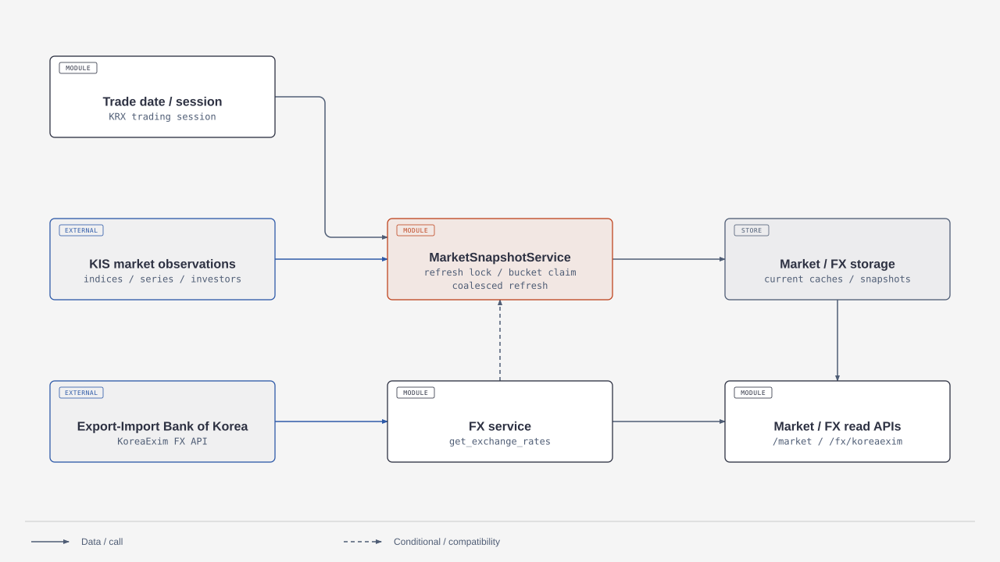

- The optional snapshot FX leg uses stored rates or a missing status when configuration, quota or provider reads prevent a fresh observation. The standalone FX API returns HTTP errors for these failures.
- Refresh uses an async lock and shares an in-flight task. The forced-index refresh path also claims a durable time bucket to avoid duplicate refreshes.
- GET /market/snapshot reads the decorated stored snapshot; it does not initiate a provider refresh when the cache is empty.

**HTTP coverage:** `/market`, `/fx/koreaexim`.

**Implementation evidence**

- [`apps/api/app/market/snapshot.py`](https://github.com/kiseyno-AI/kai-trading-core/blob/5a0ce6b4260d47c7cc8177f67be5b29f1811f2c7/apps/api/app/market/snapshot.py#L357-L450) — get_market_snapshot / refresh_market_snapshot_if_due
- [`apps/api/app/market/snapshot.py`](https://github.com/kiseyno-AI/kai-trading-core/blob/5a0ce6b4260d47c7cc8177f67be5b29f1811f2c7/apps/api/app/market/snapshot.py#L799-L894) — KIS index, series and investor calls
- [`apps/api/app/market/snapshot.py`](https://github.com/kiseyno-AI/kai-trading-core/blob/5a0ce6b4260d47c7cc8177f67be5b29f1811f2c7/apps/api/app/market/snapshot.py#L1246-L1310) — _fetch_usd_krw_snapshot
- [`apps/api/app/fx/service.py`](https://github.com/kiseyno-AI/kai-trading-core/blob/5a0ce6b4260d47c7cc8177f67be5b29f1811f2c7/apps/api/app/fx/service.py#L45-L80) — KoreaEximService.get_exchange_rates
- [`apps/api/app/api/routes_market.py`](https://github.com/kiseyno-AI/kai-trading-core/blob/5a0ce6b4260d47c7cc8177f67be5b29f1811f2c7/apps/api/app/api/routes_market.py#L34-L117) — market_status / market_snapshot
- [`apps/api/app/api/routes_fx.py`](https://github.com/kiseyno-AI/kai-trading-core/blob/5a0ce6b4260d47c7cc8177f67be5b29f1811f2c7/apps/api/app/api/routes_fx.py#L11-L32) — get_exchange_rates and error mapping

<a id="eod-orchestration"></a>

## Korean EOD execution and recovery

The automatic scheduler enters PykrxBackfillService. The stage API enters DailyPipelineStageService directly; grouped price stages reuse the same PyKRX collection runner.

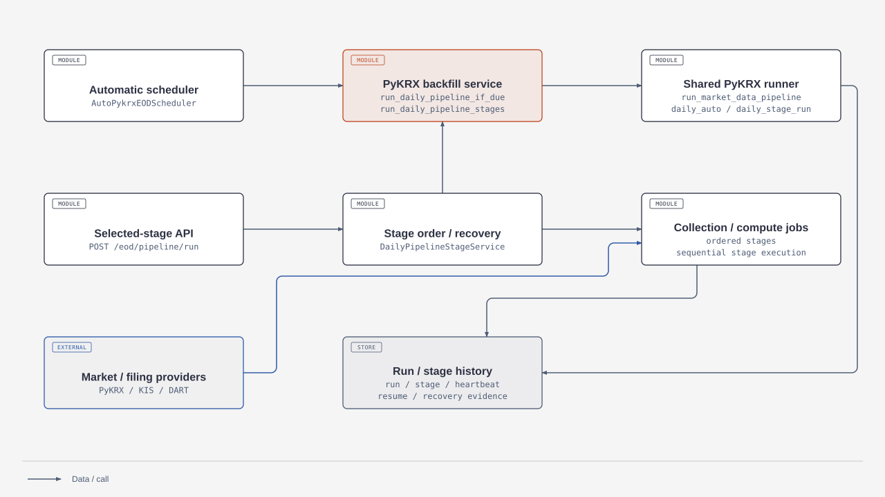

- Branches distinguish entry paths, not parallel KR stage workers. The stage service calls the backfill service for its grouped PyKRX stages.
- The shared runner uses daily_auto with chained follow-ups for the automatic path, and daily_stage_run without those follow-ups for the selected-stage path.
- The automatic runner has an early signal-feature pass and a post-factor refresh. Recovery can also resume through DailyPipelineStageService.
- The opt-in market-hours gap-fill job runs in a separate background thread task; its report/apply boundary is shown in the data-repair diagram.

**HTTP coverage:** `/eod`.

**Implementation evidence**

- [`apps/api/app/eod/runner.py`](https://github.com/kiseyno-AI/kai-trading-core/blob/5a0ce6b4260d47c7cc8177f67be5b29f1811f2c7/apps/api/app/eod/runner.py#L616-L714) — EODBackgroundRunner._run_loop
- [`apps/api/app/eod/auto_pykrx.py`](https://github.com/kiseyno-AI/kai-trading-core/blob/5a0ce6b4260d47c7cc8177f67be5b29f1811f2c7/apps/api/app/eod/auto_pykrx.py#L480-L495) — scheduler invocation of run_daily_pipeline_if_due
- [`apps/api/app/eod/pykrx_backfill.py`](https://github.com/kiseyno-AI/kai-trading-core/blob/5a0ce6b4260d47c7cc8177f67be5b29f1811f2c7/apps/api/app/eod/pykrx_backfill.py#L11252-L11265) — daily_auto runner invocation
- [`apps/api/app/eod/pykrx_backfill.py`](https://github.com/kiseyno-AI/kai-trading-core/blob/5a0ce6b4260d47c7cc8177f67be5b29f1811f2c7/apps/api/app/eod/pykrx_backfill.py#L11316-L11431) — run_daily_pipeline_stages / daily_stage_run
- [`apps/api/app/api/routes_eod.py`](https://github.com/kiseyno-AI/kai-trading-core/blob/5a0ce6b4260d47c7cc8177f67be5b29f1811f2c7/apps/api/app/api/routes_eod.py#L255-L288) — run_eod_pipeline direct stage-service entry
- [`apps/api/app/eod/daily_pipeline_stages.py`](https://github.com/kiseyno-AI/kai-trading-core/blob/5a0ce6b4260d47c7cc8177f67be5b29f1811f2c7/apps/api/app/eod/daily_pipeline_stages.py#L2481-L2508) — grouped PyKRX stage invocation
- [`apps/api/app/eod/daily_pipeline_stages.py`](https://github.com/kiseyno-AI/kai-trading-core/blob/5a0ce6b4260d47c7cc8177f67be5b29f1811f2c7/apps/api/app/eod/daily_pipeline_stages.py#L2743-L3740) — ordered stage loop and execution
- [`apps/api/app/eod/pykrx_pipeline_runner.py`](https://github.com/kiseyno-AI/kai-trading-core/blob/5a0ce6b4260d47c7cc8177f67be5b29f1811f2c7/apps/api/app/eod/pykrx_pipeline_runner.py#L1670-L1922) — run and stage tracking
- [`apps/api/app/eod/pykrx_pipeline_runner.py`](https://github.com/kiseyno-AI/kai-trading-core/blob/5a0ce6b4260d47c7cc8177f67be5b29f1811f2c7/apps/api/app/eod/pykrx_pipeline_runner.py#L5383-L5405) — early signal-feature pass
- [`apps/api/app/eod/pykrx_pipeline_runner.py`](https://github.com/kiseyno-AI/kai-trading-core/blob/5a0ce6b4260d47c7cc8177f67be5b29f1811f2c7/apps/api/app/eod/pykrx_pipeline_runner.py#L6930-L7019) — factor and post-factor follow-ups
- [`apps/api/app/eod/pykrx_backfill.py`](https://github.com/kiseyno-AI/kai-trading-core/blob/5a0ce6b4260d47c7cc8177f67be5b29f1811f2c7/apps/api/app/eod/pykrx_backfill.py#L9343-L9347) — recovery continuation through the stage service
- [`apps/api/app/eod/runner.py`](https://github.com/kiseyno-AI/kai-trading-core/blob/5a0ce6b4260d47c7cc8177f67be5b29f1811f2c7/apps/api/app/eod/runner.py#L398-L408) — non-blocking thread step / gap-fill scheduling
- [`apps/api/app/eod/runner.py`](https://github.com/kiseyno-AI/kai-trading-core/blob/5a0ce6b4260d47c7cc8177f67be5b29f1811f2c7/apps/api/app/eod/runner.py#L875-L884) — OPEN-phase gap-fill scheduling

<a id="eod-price"></a>

## Daily price collection priority

For daily_auto and daily_stage_run, collection first tries the official market-wide frame cached by market and date. An unusable symbol row falls back to the per-symbol history endpoint.

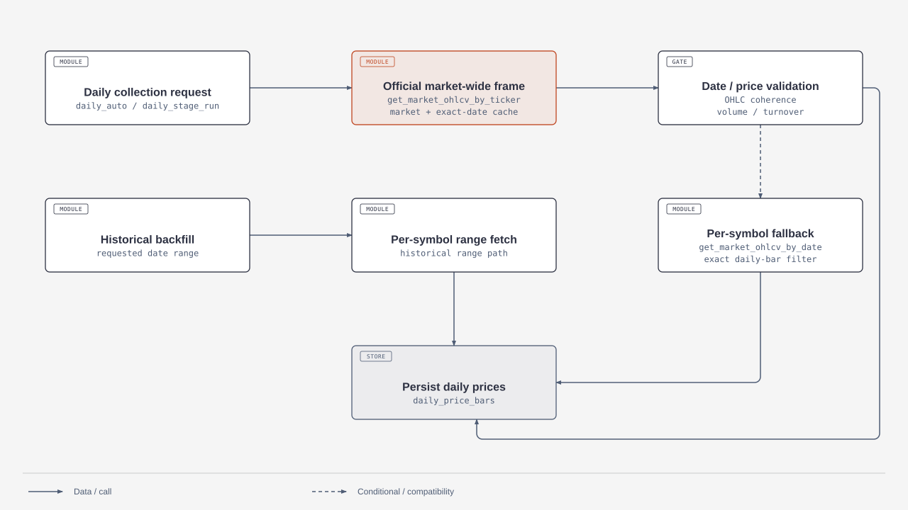

- Fallback covers an absent getter, failed market fetch, missing symbol or incomplete/inconsistent row. A traded official row must have positive turnover and coherent OHLC values.
- Historical range backfills use the per-symbol path; their source priority differs from the daily modes.
- This is the primary/fallback view. Same-run exact-market recovery and turnover enrichment can also run before persistence.

**HTTP coverage:** `/eod`.

**Implementation evidence**

- [`apps/api/app/eod/pykrx_pipeline_runner.py`](https://github.com/kiseyno-AI/kai-trading-core/blob/5a0ce6b4260d47c7cc8177f67be5b29f1811f2c7/apps/api/app/eod/pykrx_pipeline_runner.py#L2952-L3009) — _official_daily_bar
- [`apps/api/app/eod/pykrx_pipeline_runner.py`](https://github.com/kiseyno-AI/kai-trading-core/blob/5a0ce6b4260d47c7cc8177f67be5b29f1811f2c7/apps/api/app/eod/pykrx_pipeline_runner.py#L4017-L4074) — daily and historical collection branches
- [`apps/api/app/eod/pykrx_pipeline_runner.py`](https://github.com/kiseyno-AI/kai-trading-core/blob/5a0ce6b4260d47c7cc8177f67be5b29f1811f2c7/apps/api/app/eod/pykrx_pipeline_runner.py#L4074-L4187) — exact-market recovery, turnover enrichment and persistence
- [`apps/api/app/market_data_store.py`](https://github.com/kiseyno-AI/kai-trading-core/blob/5a0ce6b4260d47c7cc8177f67be5b29f1811f2c7/apps/api/app/market_data_store.py#L880-L976) — persist_daily_price_bars

<a id="eod-derived"></a>

## EOD derived data and factor inputs

Stored prices, PyKRX enrichment and DART fundamentals feed deterministic analysis. Signal features incorporate market-risk, Piotroski and factor results.

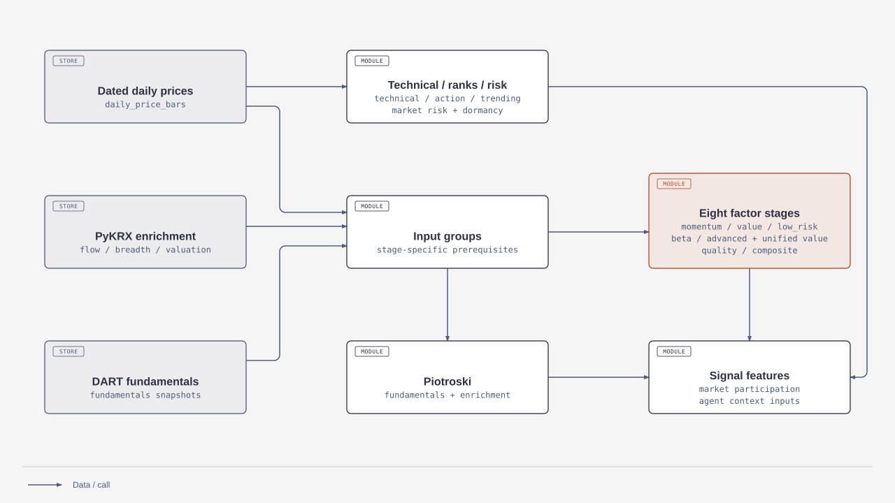

- These arrows summarize data prerequisites. Input groups are a diagram abstraction, not an extra runtime service. The upper analysis-to-feature edge denotes market-risk results, not every technical/ranking table.
- Factor prerequisites differ. Composite requires momentum, value, low_risk, beta and advanced_value; unified_value and quality are not listed composite prerequisites.
- market_risk_filter writes both risk snapshots and filter results, so the separate market_risk_snapshots stage is excluded from the default order. Stage execution remains sequential.
- Dormancy adds the blocking reason no_recent_trading only when a symbol has bars for the full configured window and none has positive volume (default: 10 stored sessions). Missing bars do not establish dormancy; positive volume clears the exclusion on rebuild.
- If the dormancy lookup fails, the risk stage logs the failure and continues without that additional check.

**HTTP coverage:** `/eod`.

**Implementation evidence**

- [`apps/api/app/eod/daily_pipeline_stages.py`](https://github.com/kiseyno-AI/kai-trading-core/blob/5a0ce6b4260d47c7cc8177f67be5b29f1811f2c7/apps/api/app/eod/daily_pipeline_stages.py#L431-L786) — STAGE_DEFINITIONS
- [`apps/api/app/eod/daily_pipeline_stages.py`](https://github.com/kiseyno-AI/kai-trading-core/blob/5a0ce6b4260d47c7cc8177f67be5b29f1811f2c7/apps/api/app/eod/daily_pipeline_stages.py#L170-L259) — factor and default stage order
- [`apps/api/app/eod/pykrx_pipeline_runner.py`](https://github.com/kiseyno-AI/kai-trading-core/blob/5a0ce6b4260d47c7cc8177f67be5b29f1811f2c7/apps/api/app/eod/pykrx_pipeline_runner.py#L6930-L7019) — factor follow-ups
- [`apps/api/app/signals/daily_signal_features.py`](https://github.com/kiseyno-AI/kai-trading-core/blob/5a0ce6b4260d47c7cc8177f67be5b29f1811f2c7/apps/api/app/signals/daily_signal_features.py#L638-L690) — stored Piotroski and market-risk inputs
- [`apps/api/app/signals/daily_signal_features.py`](https://github.com/kiseyno-AI/kai-trading-core/blob/5a0ce6b4260d47c7cc8177f67be5b29f1811f2c7/apps/api/app/signals/daily_signal_features.py#L976-L1016) — stored factor inputs
- [`apps/api/app/market_data_store.py`](https://github.com/kiseyno-AI/kai-trading-core/blob/5a0ce6b4260d47c7cc8177f67be5b29f1811f2c7/apps/api/app/market_data_store.py#L4963-L5012) — load_symbols_without_recent_trading
- [`apps/api/app/signals/market_risk_filter.py`](https://github.com/kiseyno-AI/kai-trading-core/blob/5a0ce6b4260d47c7cc8177f67be5b29f1811f2c7/apps/api/app/signals/market_risk_filter.py#L74-L174) — dormancy lookup and result augmentation
- [`apps/api/app/signals/market_risk_evaluators.py`](https://github.com/kiseyno-AI/kai-trading-core/blob/5a0ce6b4260d47c7cc8177f67be5b29f1811f2c7/apps/api/app/signals/market_risk_evaluators.py#L77-L121) — evaluate_dormancy_reasons / evaluator registration
- [`apps/api/app/core/settings.py`](https://github.com/kiseyno-AI/kai-trading-core/blob/5a0ce6b4260d47c7cc8177f67be5b29f1811f2c7/apps/api/app/core/settings.py#L260-L264) — market_risk_dormant_lookback_trading_days

<a id="dart"></a>

## DART incremental fundamentals

Daily refresh scopes corporations and receipt dates, synchronizes disclosures, and captures eligible events. Snapshot rows and successful event status are published in one transaction.

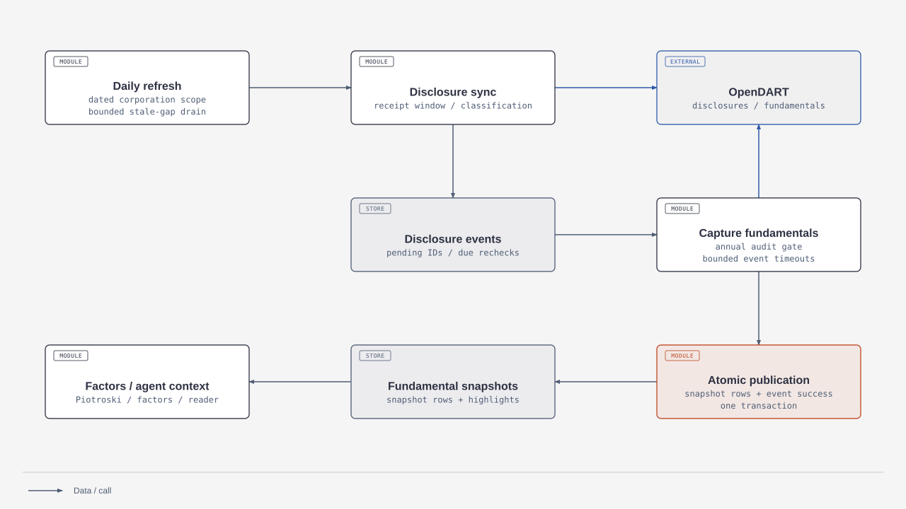

- Snapshot replacement and event-success marking share a transaction. Annual filings must first produce valid event-bound audit evidence.
- Daily refresh rotates through a bounded set of stale symbols (default: 100) from their real gap start. Initial backfill and global share-issuance handling remain separate configuration options.
- The annual-report audit-document step has a separate default timeout of 240 seconds. The subsequent fundamentals capture keeps the generic 60-second timeout.
- DART [014] file-not-found is no_data for the current run. Due events are eligible again after more than three days while attempts are below three; up to 20 due rechecks can be added outside the receipt window, within capture_limit.

**HTTP coverage:** `/disclosures/dart`.

**Implementation evidence**

- [`apps/api/app/dart/fundamentals_capture_service.py`](https://github.com/kiseyno-AI/kai-trading-core/blob/5a0ce6b4260d47c7cc8177f67be5b29f1811f2c7/apps/api/app/dart/fundamentals_capture_service.py#L2305-L2371) — run_daily_incremental_refresh entry and option branch
- [`apps/api/app/dart/sync_service.py`](https://github.com/kiseyno-AI/kai-trading-core/blob/5a0ce6b4260d47c7cc8177f67be5b29f1811f2c7/apps/api/app/dart/sync_service.py#L1548-L1670) — sync_disclosures_for_corporations
- [`apps/api/app/dart/fundamentals_capture_service.py`](https://github.com/kiseyno-AI/kai-trading-core/blob/5a0ce6b4260d47c7cc8177f67be5b29f1811f2c7/apps/api/app/dart/fundamentals_capture_service.py#L3586-L3593) — sync_group_operation
- [`apps/api/app/dart/fundamentals_capture_service.py`](https://github.com/kiseyno-AI/kai-trading-core/blob/5a0ce6b4260d47c7cc8177f67be5b29f1811f2c7/apps/api/app/dart/fundamentals_capture_service.py#L3838-L3856) — capture_operation and heartbeat
- [`apps/api/app/dart/fundamentals_store.py`](https://github.com/kiseyno-AI/kai-trading-core/blob/5a0ce6b4260d47c7cc8177f67be5b29f1811f2c7/apps/api/app/dart/fundamentals_store.py#L1349-L1389) — replace_snapshot_dataset_and_mark_event_success
- [`apps/api/app/dart/fundamentals_capture_service.py`](https://github.com/kiseyno-AI/kai-trading-core/blob/5a0ce6b4260d47c7cc8177f67be5b29f1811f2c7/apps/api/app/dart/fundamentals_capture_service.py#L191-L234) — weekday rotation / stale-drain eligibility
- [`apps/api/app/dart/fundamentals_capture_service.py`](https://github.com/kiseyno-AI/kai-trading-core/blob/5a0ce6b4260d47c7cc8177f67be5b29f1811f2c7/apps/api/app/dart/fundamentals_capture_service.py#L3280-L3316) — bounded stale-drain scope
- [`apps/api/app/dart/fundamentals_capture_service.py`](https://github.com/kiseyno-AI/kai-trading-core/blob/5a0ce6b4260d47c7cc8177f67be5b29f1811f2c7/apps/api/app/dart/fundamentals_capture_service.py#L3510-L3541) — stale-drain selection bypasses lookback deferral
- [`apps/api/app/dart/fundamentals_capture_service.py`](https://github.com/kiseyno-AI/kai-trading-core/blob/5a0ce6b4260d47c7cc8177f67be5b29f1811f2c7/apps/api/app/dart/fundamentals_capture_service.py#L1355-L1417) — annual audit gate and separate timeouts
- [`apps/api/app/dart/fundamentals_capture_service.py`](https://github.com/kiseyno-AI/kai-trading-core/blob/5a0ce6b4260d47c7cc8177f67be5b29f1811f2c7/apps/api/app/dart/fundamentals_capture_service.py#L1624-L1646) — file-not-found terminal handling
- [`apps/api/app/dart/fundamentals_store.py`](https://github.com/kiseyno-AI/kai-trading-core/blob/5a0ce6b4260d47c7cc8177f67be5b29f1811f2c7/apps/api/app/dart/fundamentals_store.py#L39-L53) — file-not-found recheck eligibility
- [`apps/api/app/dart/fundamentals_store.py`](https://github.com/kiseyno-AI/kai-trading-core/blob/5a0ce6b4260d47c7cc8177f67be5b29f1811f2c7/apps/api/app/dart/fundamentals_store.py#L591-L617) — list_file_not_found_rechecks
- [`apps/api/app/dart/fundamentals_capture_service.py`](https://github.com/kiseyno-AI/kai-trading-core/blob/5a0ce6b4260d47c7cc8177f67be5b29f1811f2c7/apps/api/app/dart/fundamentals_capture_service.py#L3741-L3768) — bounded daily recheck addition
- [`apps/api/app/core/settings.py`](https://github.com/kiseyno-AI/kai-trading-core/blob/5a0ce6b4260d47c7cc8177f67be5b29f1811f2c7/apps/api/app/core/settings.py#L234-L266) — DART timeout / backfill / drain defaults
- [`apps/api/app/eod/daily_pipeline_stages.py`](https://github.com/kiseyno-AI/kai-trading-core/blob/5a0ce6b4260d47c7cc8177f67be5b29f1811f2c7/apps/api/app/eod/daily_pipeline_stages.py#L562-L655) — Piotroski and fundamental-dependent factors
- [`apps/api/app/agent_context/read_service.py`](https://github.com/kiseyno-AI/kai-trading-core/blob/5a0ce6b4260d47c7cc8177f67be5b29f1811f2c7/apps/api/app/agent_context/read_service.py#L6723-L7041) — AgentContextReadService.get_symbol_day_context

<a id="data-repair"></a>

## Gap filling and audited price repair

Gap filling is opt-in and report-only unless apply is enabled. Manual price restatement has separate evidence gates; applied rewrites create pending batches that block startup until required rebuilds are verified and completed.

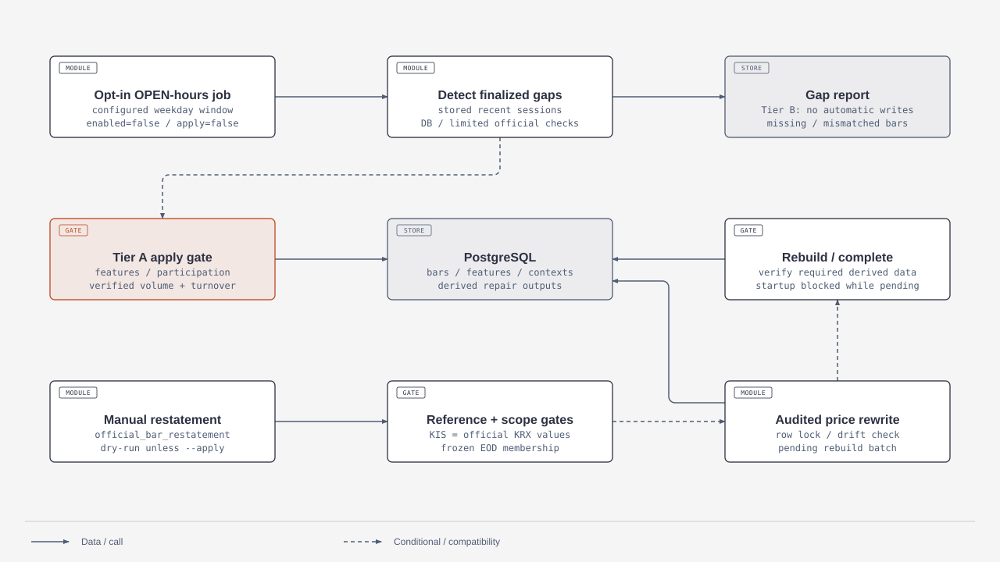

- The background job is disabled by default. Enabling it still reports only unless DATA_GAP_FILL_APPLY is true. Its CLI also defaults to a report and bypasses scheduling, not finality checks.
- Tier A apply fills missing stored-data signal features, rebuilds participation context, and patches verified volume/turnover under existing writer fences. Budget checks before each fixer and failure/no-progress cooldowns defer work.
- Tier B missing or mismatched price bars are report-only. Gap filling never invokes the manual restatement path.
- Turnover partial-verified mode writes only rows with matching provider/stored OHLC and valid, nondecreasing liquidity. Unverified rows remain untouched; structural provider-membership mismatch still blocks the date.
- Restatement requires both-market official coverage, exact KIS agreement on all six bar values, the close-change bound, and strict EOD membership for every rebuild date. Evidence is frozen after the write inside the same transaction.
- Applied rewrites record before/after audit rows and a pending batch. Required numeric/evaluation rebuilds and explicit verified completion must finish before Core startup can pass its pending-repair check.

**HTTP coverage:** `/eod`, `/data-repair`.

**Implementation evidence**

- [`apps/api/app/core/settings.py`](https://github.com/kiseyno-AI/kai-trading-core/blob/5a0ce6b4260d47c7cc8177f67be5b29f1811f2c7/apps/api/app/core/settings.py#L249-L259) — gap-fill defaults
- [`apps/api/app/eod/runner.py`](https://github.com/kiseyno-AI/kai-trading-core/blob/5a0ce6b4260d47c7cc8177f67be5b29f1811f2c7/apps/api/app/eod/runner.py#L398-L408) — non-blocking background thread step
- [`apps/api/app/eod/runner.py`](https://github.com/kiseyno-AI/kai-trading-core/blob/5a0ce6b4260d47c7cc8177f67be5b29f1811f2c7/apps/api/app/eod/runner.py#L875-L884) — OPEN-phase gap-fill entry
- [`apps/api/app/eod/data_gap_fill.py`](https://github.com/kiseyno-AI/kai-trading-core/blob/5a0ce6b4260d47c7cc8177f67be5b29f1811f2c7/apps/api/app/eod/data_gap_fill.py#L88-L228) — DataGapFillService schedule / finality / detection / apply
- [`apps/api/app/eod/data_gap_fill.py`](https://github.com/kiseyno-AI/kai-trading-core/blob/5a0ce6b4260d47c7cc8177f67be5b29f1811f2c7/apps/api/app/eod/data_gap_fill.py#L246-L256) — load_recent_sessions
- [`apps/api/app/eod/data_gap_fill.py`](https://github.com/kiseyno-AI/kai-trading-core/blob/5a0ce6b4260d47c7cc8177f67be5b29f1811f2c7/apps/api/app/eod/data_gap_fill.py#L452-L533) — default fixer wiring and CLI apply gate
- [`apps/api/app/eod/stored_signal_feature_backfill.py`](https://github.com/kiseyno-AI/kai-trading-core/blob/5a0ce6b4260d47c7cc8177f67be5b29f1811f2c7/apps/api/app/eod/stored_signal_feature_backfill.py#L132-L176) — apply_backfill writer fence and missing-row write
- [`apps/api/app/market_data_store.py`](https://github.com/kiseyno-AI/kai-trading-core/blob/5a0ce6b4260d47c7cc8177f67be5b29f1811f2c7/apps/api/app/market_data_store.py#L989-L1030) — partial-verified turnover repair conditions
- [`apps/api/app/market_data_store.py`](https://github.com/kiseyno-AI/kai-trading-core/blob/5a0ce6b4260d47c7cc8177f67be5b29f1811f2c7/apps/api/app/market_data_store.py#L1161-L1249) — OHLC and liquidity checks / structural blocking
- [`apps/api/app/market_data_store.py`](https://github.com/kiseyno-AI/kai-trading-core/blob/5a0ce6b4260d47c7cc8177f67be5b29f1811f2c7/apps/api/app/market_data_store.py#L1352-L1385) — paired liquidity write
- [`apps/api/app/eod/official_bar_restatement.py`](https://github.com/kiseyno-AI/kai-trading-core/blob/5a0ce6b4260d47c7cc8177f67be5b29f1811f2c7/apps/api/app/eod/official_bar_restatement.py#L81-L144) — OfficialReference.load completeness
- [`apps/api/app/eod/official_bar_restatement.py`](https://github.com/kiseyno-AI/kai-trading-core/blob/5a0ce6b4260d47c7cc8177f67be5b29f1811f2c7/apps/api/app/eod/official_bar_restatement.py#L176-L236) — plan_official_restatement
- [`apps/api/app/eod/official_bar_restatement.py`](https://github.com/kiseyno-AI/kai-trading-core/blob/5a0ce6b4260d47c7cc8177f67be5b29f1811f2c7/apps/api/app/eod/official_bar_restatement.py#L246-L284) — frozen rebuild evidence / proof preflight
- [`apps/api/app/eod/official_bar_restatement.py`](https://github.com/kiseyno-AI/kai-trading-core/blob/5a0ce6b4260d47c7cc8177f67be5b29f1811f2c7/apps/api/app/eod/official_bar_restatement.py#L313-L356) — dry-run / apply CLI and proof gate
- [`apps/api/app/eod/kis_final_bar_repair.py`](https://github.com/kiseyno-AI/kai-trading-core/blob/5a0ce6b4260d47c7cc8177f67be5b29f1811f2c7/apps/api/app/eod/kis_final_bar_repair.py#L607-L887) — locked drift check / pending batch / audit / verified write
- [`apps/api/app/eod/price_bar_repair_state.py`](https://github.com/kiseyno-AI/kai-trading-core/blob/5a0ce6b4260d47c7cc8177f67be5b29f1811f2c7/apps/api/app/eod/price_bar_repair_state.py#L316-L365) — pending-rebuild startup gate
- [`apps/api/app/eod/price_bar_repair_state.py`](https://github.com/kiseyno-AI/kai-trading-core/blob/5a0ce6b4260d47c7cc8177f67be5b29f1811f2c7/apps/api/app/eod/price_bar_repair_state.py#L4834-L4858) — verified explicit batch completion
- [`apps/api/app/main.py`](https://github.com/kiseyno-AI/kai-trading-core/blob/5a0ce6b4260d47c7cc8177f67be5b29f1811f2c7/apps/api/app/main.py#L120-L128) — lifespan pending-repair check

<a id="external-evidence"></a>

## External news and macro evidence

Symbol news, topic news and macro observations use separate collection and storage paths. Their actual consumers are shown independently from the generic external-context foundation.

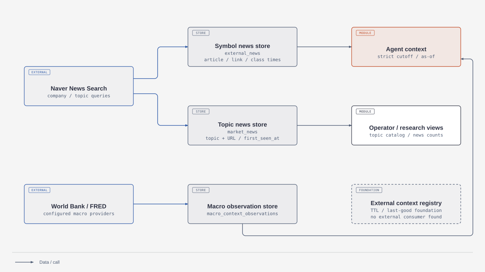

- The EOD runner starts topic-news collection when due. Operator endpoints and the business-line report consume the topic store; no direct AgentContextReadService dependency was found.
- Symbol-news context enforces publication, collection, symbol-association and classification cutoffs. Macro observations are contextual inputs, not direct buy/sell signals.
- The generic registry has no production consumer outside its package in this snapshot. FRED collection depends on configuration and credentials; deployed provider status was not inspected.

**HTTP coverage:** `/external/news`, `/macro`.

**Implementation evidence**

- [`apps/api/app/external_news/service.py`](https://github.com/kiseyno-AI/kai-trading-core/blob/5a0ce6b4260d47c7cc8177f67be5b29f1811f2c7/apps/api/app/external_news/service.py#L123-L334) — ExternalNewsService.collect_for_symbols
- [`apps/api/app/external_news/store.py`](https://github.com/kiseyno-AI/kai-trading-core/blob/5a0ce6b4260d47c7cc8177f67be5b29f1811f2c7/apps/api/app/external_news/store.py#L383-L478) — list_external_news_items
- [`apps/api/app/market_news/service.py`](https://github.com/kiseyno-AI/kai-trading-core/blob/5a0ce6b4260d47c7cc8177f67be5b29f1811f2c7/apps/api/app/market_news/service.py#L42-L153) — MarketNewsService.collect / _store / collect_if_due
- [`apps/api/app/macro_context/service.py`](https://github.com/kiseyno-AI/kai-trading-core/blob/5a0ce6b4260d47c7cc8177f67be5b29f1811f2c7/apps/api/app/macro_context/service.py#L404-L580) — MacroContextService.refresh_context / get_context
- [`apps/api/app/agent_context/read_service.py`](https://github.com/kiseyno-AI/kai-trading-core/blob/5a0ce6b4260d47c7cc8177f67be5b29f1811f2c7/apps/api/app/agent_context/read_service.py#L6723-L7041) — AgentContextReadService.get_symbol_day_context
- [`apps/api/app/market/business_line_conditions.py`](https://github.com/kiseyno-AI/kai-trading-core/blob/5a0ce6b4260d47c7cc8177f67be5b29f1811f2c7/apps/api/app/market/business_line_conditions.py#L350-L419) — news_section / main
- [`apps/api/app/external_context/service.py`](https://github.com/kiseyno-AI/kai-trading-core/blob/5a0ce6b4260d47c7cc8177f67be5b29f1811f2c7/apps/api/app/external_context/service.py#L81-L223) — ExternalContextService.get_context
- [`apps/api/app/eod/runner.py`](https://github.com/kiseyno-AI/kai-trading-core/blob/5a0ce6b4260d47c7cc8177f67be5b29f1811f2c7/apps/api/app/eod/runner.py#L585-L628) — _start_market_news_collect_if_due / _run_loop

<a id="context"></a>

## Per-symbol decision context

Stored price, technical, factor, financial, news and macro evidence is read for the requested symbol and market date. Coverage, provenance and signal envelopes accompany the agent payload.

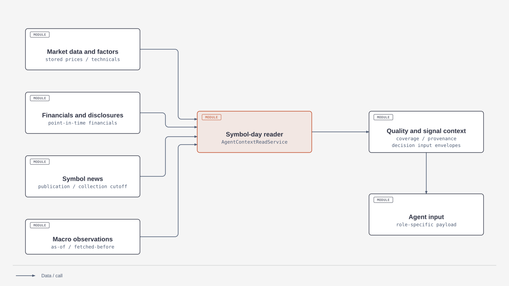

- Arrows show data dependencies between read models and modules, not independently deployed services.
- Source timestamps and requested-symbol coverage remain attached to the input. Macro observations supply context only.

**HTTP coverage:** `/agent-context`.

**Implementation evidence**

- [`apps/api/app/agent_context/read_service.py`](https://github.com/kiseyno-AI/kai-trading-core/blob/5a0ce6b4260d47c7cc8177f67be5b29f1811f2c7/apps/api/app/agent_context/read_service.py#L6723-L7041) — AgentContextReadService.get_symbol_day_context
- [`apps/api/app/agent_context/read_service.py`](https://github.com/kiseyno-AI/kai-trading-core/blob/5a0ce6b4260d47c7cc8177f67be5b29f1811f2c7/apps/api/app/agent_context/read_service.py#L7532-L7574) — build_decision_input_quality_envelope / build_symbol_signal_envelopes calls
- [`apps/api/app/agent_context/read_service.py`](https://github.com/kiseyno-AI/kai-trading-core/blob/5a0ce6b4260d47c7cc8177f67be5b29f1811f2c7/apps/api/app/agent_context/read_service.py#L7960-L8034) — AgentContextReadService.get_symbol_day_context return

<a id="agents"></a>

## Three summaries, two decision lanes

Each symbol needs all three specialist summaries before either decider can proceed. Short-term and signal decisions have independent objectives and consume the same required summary bundle.

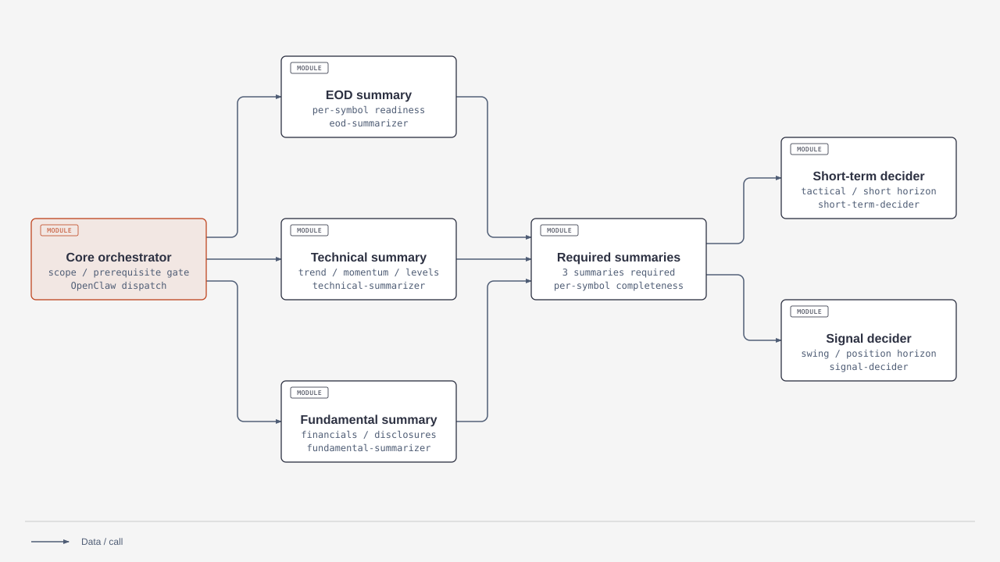

- Summary-to-decider arrows represent data dependencies. Core invokes every external role through OpenClaw; the specialists do not call the deciders directly.
- Runtime role order is EOD, technical, fundamental, short-term, then signal. Symbol chunks run in parallel within the current role.
- The two decision lanes do not approve or size orders for one another. Their structured outputs remain decision support; execution authority is validated separately.

**HTTP coverage:** `/agent-context`.

**Implementation evidence**

- [`apps/api/app/agent_context/roles.py`](https://github.com/kiseyno-AI/kai-trading-core/blob/5a0ce6b4260d47c7cc8177f67be5b29f1811f2c7/apps/api/app/agent_context/roles.py#L5-L25) — SUMMARIZER_AGENT_NAMES / DECISION_SUPPORT_AGENT_NAMES
- [`apps/api/app/agent_context/orchestrator.py`](https://github.com/kiseyno-AI/kai-trading-core/blob/5a0ce6b4260d47c7cc8177f67be5b29f1811f2c7/apps/api/app/agent_context/orchestrator.py#L501-L552) — DISPATCH_SPECS
- [`apps/api/app/agent_context/orchestrator.py`](https://github.com/kiseyno-AI/kai-trading-core/blob/5a0ce6b4260d47c7cc8177f67be5b29f1811f2c7/apps/api/app/agent_context/orchestrator.py#L5048-L5193) — AgentFeedbackOrchestrator._prepare_role_dispatch_items
- [`apps/api/app/agent_context/orchestrator.py`](https://github.com/kiseyno-AI/kai-trading-core/blob/5a0ce6b4260d47c7cc8177f67be5b29f1811f2c7/apps/api/app/agent_context/orchestrator.py#L7470-L7687) — role-sequential loop / parallel chunk executor
- [`apps/api/app/agent_context/orchestrator.py`](https://github.com/kiseyno-AI/kai-trading-core/blob/5a0ce6b4260d47c7cc8177f67be5b29f1811f2c7/apps/api/app/agent_context/orchestrator.py#L2926-L3035) — OpenClawAgentClient.dispatch_batch

<a id="feedback"></a>

## Response validation, retries and history

Retries preserve parent/child run identity and exact role/symbol scopes. Mutable latest feedback and immutable decision snapshots serve different persistence and audit purposes.

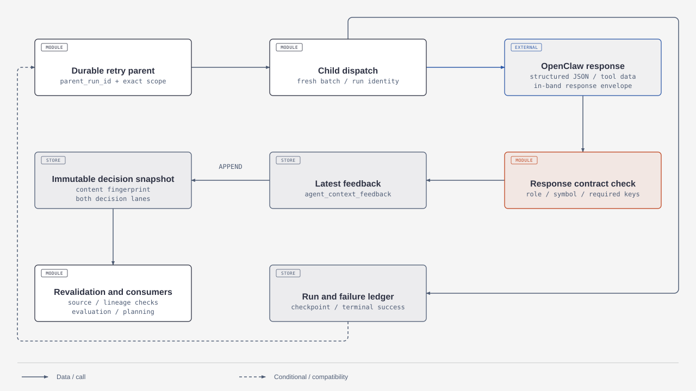

- Latest feedback is upserted by market date, symbol and role. Both decision lanes also append content-fingerprinted snapshots, deduplicating identical content.
- The batch function result is parsed within the OpenClaw response; it is not a separate HTTP callback. POST /agent-context/feedback is an additional ingress path.
- Downstream consumers use snapshot identity and source/run lineage, rather than treating the latest mutable feedback row as historical authority.

**HTTP coverage:** `/agent-context`.

**Implementation evidence**

- [`apps/api/app/agent_context/retry_service.py`](https://github.com/kiseyno-AI/kai-trading-core/blob/5a0ce6b4260d47c7cc8177f67be5b29f1811f2c7/apps/api/app/agent_context/retry_service.py#L6350-L6398) — durable parent start / runtime state
- [`apps/api/app/agent_context/retry_service.py`](https://github.com/kiseyno-AI/kai-trading-core/blob/5a0ce6b4260d47c7cc8177f67be5b29f1811f2c7/apps/api/app/agent_context/retry_service.py#L6531-L6600) — dispatch_for_symbols with parent_run_id
- [`apps/api/app/agent_context/orchestrator.py`](https://github.com/kiseyno-AI/kai-trading-core/blob/5a0ce6b4260d47c7cc8177f67be5b29f1811f2c7/apps/api/app/agent_context/orchestrator.py#L2926-L3035) — OpenClawAgentClient.dispatch_batch
- [`apps/api/app/agent_context/response_contract.py`](https://github.com/kiseyno-AI/kai-trading-core/blob/5a0ce6b4260d47c7cc8177f67be5b29f1811f2c7/apps/api/app/agent_context/response_contract.py#L19-L83) — required response keys / action sets
- [`apps/api/app/agent_context/feedback_service.py`](https://github.com/kiseyno-AI/kai-trading-core/blob/5a0ce6b4260d47c7cc8177f67be5b29f1811f2c7/apps/api/app/agent_context/feedback_service.py#L178-L278) — AgentContextFeedbackRepository.create_feedback
- [`apps/api/app/agent_context/signal_decider_loop_service.py`](https://github.com/kiseyno-AI/kai-trading-core/blob/5a0ce6b4260d47c7cc8177f67be5b29f1811f2c7/apps/api/app/agent_context/signal_decider_loop_service.py#L1844-L1908) — SignalDeciderLoopRepository.insert_decision_snapshots
- [`apps/api/app/agent_context/signal_decider_loop_service.py`](https://github.com/kiseyno-AI/kai-trading-core/blob/5a0ce6b4260d47c7cc8177f67be5b29f1811f2c7/apps/api/app/agent_context/signal_decider_loop_service.py#L3131-L3432) — SignalDeciderLoopService.prepare_snapshot_persistence_item
- [`apps/api/app/api/routes_agent_context.py`](https://github.com/kiseyno-AI/kai-trading-core/blob/5a0ce6b4260d47c7cc8177f67be5b29f1811f2c7/apps/api/app/api/routes_agent_context.py#L827-L843) — submit_agent_feedback

<a id="execution"></a>

## KR plan registration, activation and readback

Core validates decision evidence and persists a plan plus dispatch write-ahead state before registration. It stores the acknowledgement, requests activation separately, and reconciles scoped remote state.

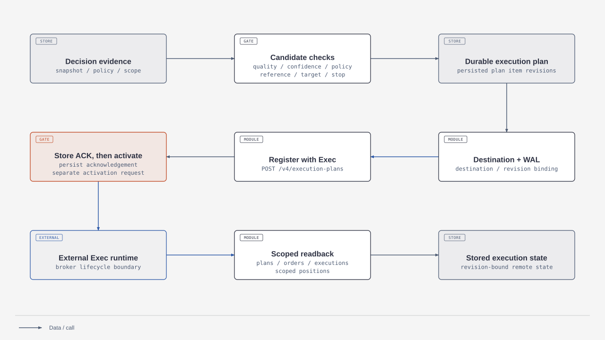

- Registration, activation and a filled order are separate states. A successful registration is not evidence of a fill.
- Core polls remote state. Position reads require external_plan_id and the accepted execution_plan_id, followed by scope-proof validation.
- Core empties its local next-open BUY candidate list in every integration mode. Disabled integration does not enable a direct KIS next-open fallback.
- Code defaults: integration mode disabled, next-open enabled=false, dry_run=true. Actual deployment settings were not inspected.
- Exec is external. Core validates a KIS/KRX/KRW handoff contract; this diagram does not verify Exec internals or live broker behavior.

**HTTP coverage:** `/trading/orders`, `/execution/runtime`.

**Implementation evidence**

- [`apps/api/app/orders/next_open_execution.py`](https://github.com/kiseyno-AI/kai-trading-core/blob/5a0ce6b4260d47c7cc8177f67be5b29f1811f2c7/apps/api/app/orders/next_open_execution.py#L4347-L4394) — refresh_plan_if_due / revision retry
- [`apps/api/app/orders/next_open_execution.py`](https://github.com/kiseyno-AI/kai-trading-core/blob/5a0ce6b4260d47c7cc8177f67be5b29f1811f2c7/apps/api/app/orders/next_open_execution.py#L8459-L8790) — _build_validation_payload
- [`apps/api/app/orders/exec_integration.py`](https://github.com/kiseyno-AI/kai-trading-core/blob/5a0ce6b4260d47c7cc8177f67be5b29f1811f2c7/apps/api/app/orders/exec_integration.py#L5630-L5667) — dispatch WAL before registration
- [`apps/api/app/orders/exec_integration.py`](https://github.com/kiseyno-AI/kai-trading-core/blob/5a0ce6b4260d47c7cc8177f67be5b29f1811f2c7/apps/api/app/orders/exec_integration.py#L5856-L5882) — persist ACK before separate activation
- [`apps/api/app/orders/exec_integration.py`](https://github.com/kiseyno-AI/kai-trading-core/blob/5a0ce6b4260d47c7cc8177f67be5b29f1811f2c7/apps/api/app/orders/exec_integration.py#L11631-L11669) — _refresh_exec_readback / scoped positions
- [`apps/api/app/orders/next_open_execution.py`](https://github.com/kiseyno-AI/kai-trading-core/blob/5a0ce6b4260d47c7cc8177f67be5b29f1811f2c7/apps/api/app/orders/next_open_execution.py#L5663-L5671) — unconditional local next-open BUY block
- [`apps/api/app/orders/execution_handoff_contract.py`](https://github.com/kiseyno-AI/kai-trading-core/blob/5a0ce6b4260d47c7cc8177f67be5b29f1811f2c7/apps/api/app/orders/execution_handoff_contract.py#L389-L415) — ExecutionPlanDispatchItemPayload.validate_exact_identity
- [`apps/api/app/core/settings.py`](https://github.com/kiseyno-AI/kai-trading-core/blob/5a0ce6b4260d47c7cc8177f67be5b29f1811f2c7/apps/api/app/core/settings.py#L135-L137) — next-open defaults
- [`apps/api/app/core/settings.py`](https://github.com/kiseyno-AI/kai-trading-core/blob/5a0ce6b4260d47c7cc8177f67be5b29f1811f2c7/apps/api/app/core/settings.py#L159-L164) — Exec integration defaults

<a id="orders"></a>

## Direct domestic orders and reconciliation

Direct buy, sell and amend routes are disabled by default. When explicitly enabled, they use the durable domestic KIS order service. Matched order notices and broker inquiries reconcile persisted order state.

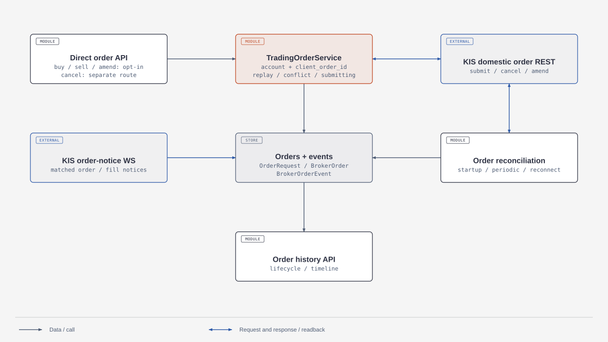

- TRADING_DIRECT_ORDER_API_ENABLED defaults to false. POST buy, sell and amend return HTTP 403 while it is false. Cancel is deliberately outside this gate; read and reconciliation routes also remain outside it.
- This FastAPI dependency guards selected HTTP routes, not all calls to TradingOrderService. Internal compatibility callers have separate feature and dry-run controls.
- The direct-order opt-in does not enable the permanently empty local next-open BUY candidate list.
- The verified submission path uses domestic KIS cash orders. Remote Exec kill-switch readback is not evidence of a universal guard on this local service.

**HTTP coverage:** `/trading/orders`.

**Implementation evidence**

- [`apps/api/app/api/routes_trading.py`](https://github.com/kiseyno-AI/kai-trading-core/blob/5a0ce6b4260d47c7cc8177f67be5b29f1811f2c7/apps/api/app/api/routes_trading.py#L126-L139) — require_direct_order_api_enabled
- [`apps/api/app/api/routes_trading.py`](https://github.com/kiseyno-AI/kai-trading-core/blob/5a0ce6b4260d47c7cc8177f67be5b29f1811f2c7/apps/api/app/api/routes_trading.py#L181-L200) — gated buy and sell routes
- [`apps/api/app/api/routes_trading.py`](https://github.com/kiseyno-AI/kai-trading-core/blob/5a0ce6b4260d47c7cc8177f67be5b29f1811f2c7/apps/api/app/api/routes_trading.py#L456-L484) — ungated cancel / gated amend
- [`apps/api/app/core/settings.py`](https://github.com/kiseyno-AI/kai-trading-core/blob/5a0ce6b4260d47c7cc8177f67be5b29f1811f2c7/apps/api/app/core/settings.py#L130-L137) — trading_direct_order_api_enabled default
- [`apps/api/app/orders/service.py`](https://github.com/kiseyno-AI/kai-trading-core/blob/5a0ce6b4260d47c7cc8177f67be5b29f1811f2c7/apps/api/app/orders/service.py#L908-L1045) — _submit_cash_order / durable idempotency
- [`apps/api/app/orders/service.py`](https://github.com/kiseyno-AI/kai-trading-core/blob/5a0ce6b4260d47c7cc8177f67be5b29f1811f2c7/apps/api/app/orders/service.py#L187-L337) — cancel_order
- [`apps/api/app/orders/service.py`](https://github.com/kiseyno-AI/kai-trading-core/blob/5a0ce6b4260d47c7cc8177f67be5b29f1811f2c7/apps/api/app/orders/service.py#L475-L628) — amend_order
- [`apps/api/app/orders/service.py`](https://github.com/kiseyno-AI/kai-trading-core/blob/5a0ce6b4260d47c7cc8177f67be5b29f1811f2c7/apps/api/app/orders/service.py#L815-L884) — reconcile_order / reconcile_persisted_order
- [`apps/api/app/orders/reconciliation.py`](https://github.com/kiseyno-AI/kai-trading-core/blob/5a0ce6b4260d47c7cc8177f67be5b29f1811f2c7/apps/api/app/orders/reconciliation.py#L95-L132) — startup and periodic reconciliation
- [`apps/api/app/orders/kis_realtime_order_notices.py`](https://github.com/kiseyno-AI/kai-trading-core/blob/5a0ce6b4260d47c7cc8177f67be5b29f1811f2c7/apps/api/app/orders/kis_realtime_order_notices.py#L478-L490) — reconnect scheduling
- [`apps/api/app/orders/kis_realtime_order_notices.py`](https://github.com/kiseyno-AI/kai-trading-core/blob/5a0ce6b4260d47c7cc8177f67be5b29f1811f2c7/apps/api/app/orders/kis_realtime_order_notices.py#L560-L619) — matched notice ingestion

<a id="auto-sell"></a>

## Compatibility auto-sell from linked positions

Sellable account quantities and linked entry tranches produce watch rows. Observed prices are checked against target and stop thresholds before a dry-run record or an internal compatibility sell submission.

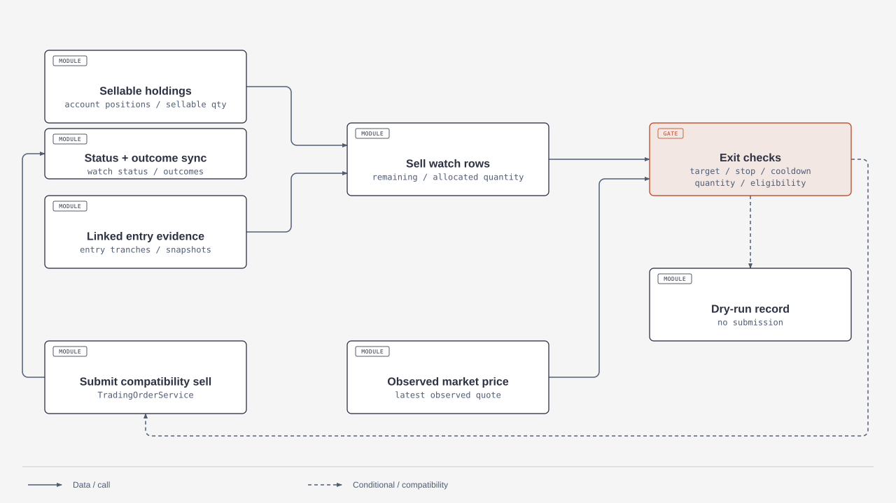

- Code defaults: auto-sell enabled=false and dry_run=true. Actual holdings, watch rows and deployment settings were not inspected.
- The background runner selects this local compatibility branch only when delegated execution and managed delegated authority do not take precedence.
- HTTP run requests are bounded by the server auto-sell enabled/dry-run settings. The direct buy/sell/amend API gate does not wrap this internal TradingOrderService call.

**HTTP coverage:** `/trading/orders`.

**Implementation evidence**

- [`apps/api/app/orders/intraday_auto_sell.py`](https://github.com/kiseyno-AI/kai-trading-core/blob/5a0ce6b4260d47c7cc8177f67be5b29f1811f2c7/apps/api/app/orders/intraday_auto_sell.py#L329-L481) — position refresh / execution controls
- [`apps/api/app/orders/intraday_auto_sell.py`](https://github.com/kiseyno-AI/kai-trading-core/blob/5a0ce6b4260d47c7cc8177f67be5b29f1811f2c7/apps/api/app/orders/intraday_auto_sell.py#L518-L640) — linked quantities and exit validation
- [`apps/api/app/orders/intraday_auto_sell.py`](https://github.com/kiseyno-AI/kai-trading-core/blob/5a0ce6b4260d47c7cc8177f67be5b29f1811f2c7/apps/api/app/orders/intraday_auto_sell.py#L799-L883) — observed price / trigger / cooldown
- [`apps/api/app/orders/intraday_auto_sell.py`](https://github.com/kiseyno-AI/kai-trading-core/blob/5a0ce6b4260d47c7cc8177f67be5b29f1811f2c7/apps/api/app/orders/intraday_auto_sell.py#L1472-L1486) — submit_sell_order
- [`apps/api/app/orders/intraday_auto_sell.py`](https://github.com/kiseyno-AI/kai-trading-core/blob/5a0ce6b4260d47c7cc8177f67be5b29f1811f2c7/apps/api/app/orders/intraday_auto_sell.py#L1556-L1598) — watch persistence / outcome sync
- [`apps/api/app/eod/runner.py`](https://github.com/kiseyno-AI/kai-trading-core/blob/5a0ce6b4260d47c7cc8177f67be5b29f1811f2c7/apps/api/app/eod/runner.py#L830-L854) — managed authority and local compatibility branch
- [`apps/api/app/api/routes_trading.py`](https://github.com/kiseyno-AI/kai-trading-core/blob/5a0ce6b4260d47c7cc8177f67be5b29f1811f2c7/apps/api/app/api/routes_trading.py#L142-L178) — server-bounded HTTP run request
- [`apps/api/app/api/routes_trading.py`](https://github.com/kiseyno-AI/kai-trading-core/blob/5a0ce6b4260d47c7cc8177f67be5b29f1811f2c7/apps/api/app/api/routes_trading.py#L425-L448) — delegated watch or compatibility auto-sell run
- [`apps/api/app/core/settings.py`](https://github.com/kiseyno-AI/kai-trading-core/blob/5a0ce6b4260d47c7cc8177f67be5b29f1811f2c7/apps/api/app/core/settings.py#L179-L181) — auto-sell defaults

<a id="monitoring"></a>

## Execution, price and portfolio read models

Core provides JSON and SSE for external operator clients. Account summaries, persisted Exec readback and WebSocket prices remain distinct read models with their own caches and refresh behavior.

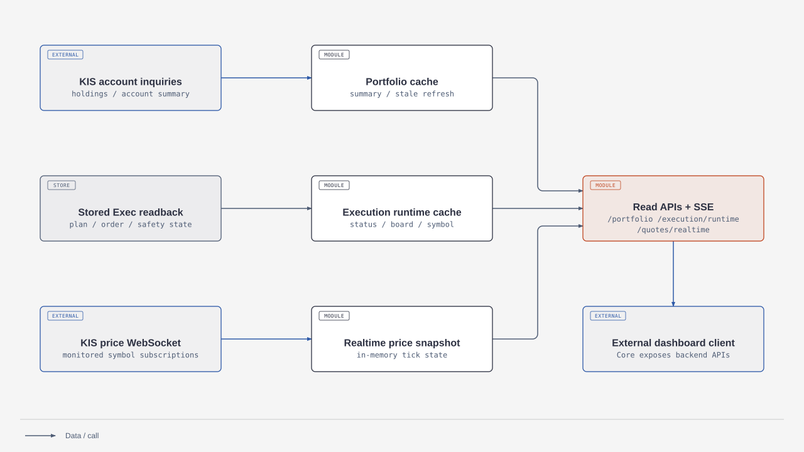

- The dashboard is an external API consumer; the Core repository contains the backend service.
- SSE prices events are emitted when the serialized monitored-price snapshot changes.
- Runtime dashboards read persisted local state and use bounded, debounced background refresh. A read model is not a live broker-readiness check.
- Exec kill-switch and ready fields normalize remote state. They do not establish a universal local direct-order guard.

**HTTP coverage:** `/portfolio`, `/execution/runtime`, `/quotes`.

**Implementation evidence**

- [`AGENTS.md`](https://github.com/kiseyno-AI/kai-trading-core/blob/5a0ce6b4260d47c7cc8177f67be5b29f1811f2c7/AGENTS.md#L3-L5) — backend repository boundary
- [`apps/api/app/orders/portfolio_summary_service.py`](https://github.com/kiseyno-AI/kai-trading-core/blob/5a0ce6b4260d47c7cc8177f67be5b29f1811f2c7/apps/api/app/orders/portfolio_summary_service.py#L168-L205) — cache-first portfolio summary
- [`apps/api/app/orders/portfolio_summary_service.py`](https://github.com/kiseyno-AI/kai-trading-core/blob/5a0ce6b4260d47c7cc8177f67be5b29f1811f2c7/apps/api/app/orders/portfolio_summary_service.py#L401-L612) — account aggregation / portfolio snapshots
- [`apps/api/app/orders/exec_integration.py`](https://github.com/kiseyno-AI/kai-trading-core/blob/5a0ce6b4260d47c7cc8177f67be5b29f1811f2c7/apps/api/app/orders/exec_integration.py#L8297-L8422) — local dashboard read / background refresh
- [`apps/api/app/orders/exec_integration.py`](https://github.com/kiseyno-AI/kai-trading-core/blob/5a0ce6b4260d47c7cc8177f67be5b29f1811f2c7/apps/api/app/orders/exec_integration.py#L8576-L8780) — dashboard cache / freshness
- [`apps/api/app/quotes/kis_realtime_prices.py`](https://github.com/kiseyno-AI/kai-trading-core/blob/5a0ce6b4260d47c7cc8177f67be5b29f1811f2c7/apps/api/app/quotes/kis_realtime_prices.py#L1245-L1254) — monitored subscription source
- [`apps/api/app/quotes/kis_realtime_prices.py`](https://github.com/kiseyno-AI/kai-trading-core/blob/5a0ce6b4260d47c7cc8177f67be5b29f1811f2c7/apps/api/app/quotes/kis_realtime_prices.py#L1474-L1558) — subscription synchronization
- [`apps/api/app/quotes/kis_realtime_prices.py`](https://github.com/kiseyno-AI/kai-trading-core/blob/5a0ce6b4260d47c7cc8177f67be5b29f1811f2c7/apps/api/app/quotes/kis_realtime_prices.py#L1621-L1806) — price ingestion and monitored snapshot
- [`apps/api/app/api/routes_execution_runtime.py`](https://github.com/kiseyno-AI/kai-trading-core/blob/5a0ce6b4260d47c7cc8177f67be5b29f1811f2c7/apps/api/app/api/routes_execution_runtime.py#L10-L73) — runtime status / board / symbol routes
- [`apps/api/app/api/routes_portfolio.py`](https://github.com/kiseyno-AI/kai-trading-core/blob/5a0ce6b4260d47c7cc8177f67be5b29f1811f2c7/apps/api/app/api/routes_portfolio.py#L9-L19) — portfolio summary route
- [`apps/api/app/api/routes_quotes.py`](https://github.com/kiseyno-AI/kai-trading-core/blob/5a0ce6b4260d47c7cc8177f67be5b29f1811f2c7/apps/api/app/api/routes_quotes.py#L20-L49) — monitored snapshots and SSE
- [`apps/api/app/orders/exec_integration.py`](https://github.com/kiseyno-AI/kai-trading-core/blob/5a0ce6b4260d47c7cc8177f67be5b29f1811f2c7/apps/api/app/orders/exec_integration.py#L14278-L14300) — remote safety read model
- [`apps/api/app/core/settings.py`](https://github.com/kiseyno-AI/kai-trading-core/blob/5a0ce6b4260d47c7cc8177f67be5b29f1811f2c7/apps/api/app/core/settings.py#L128-L129) — portfolio cache default
- [`apps/api/app/core/settings.py`](https://github.com/kiseyno-AI/kai-trading-core/blob/5a0ce6b4260d47c7cc8177f67be5b29f1811f2c7/apps/api/app/core/settings.py#L176-L178) — dashboard cache / debounce / timeout defaults

<a id="operations"></a>

## Account inquiries and broker operations

Account queries expose summaries, positions and buying power. Broker operations provide local health metadata, authorized token operations, quote queries and intraday snapshot collection and inspection.

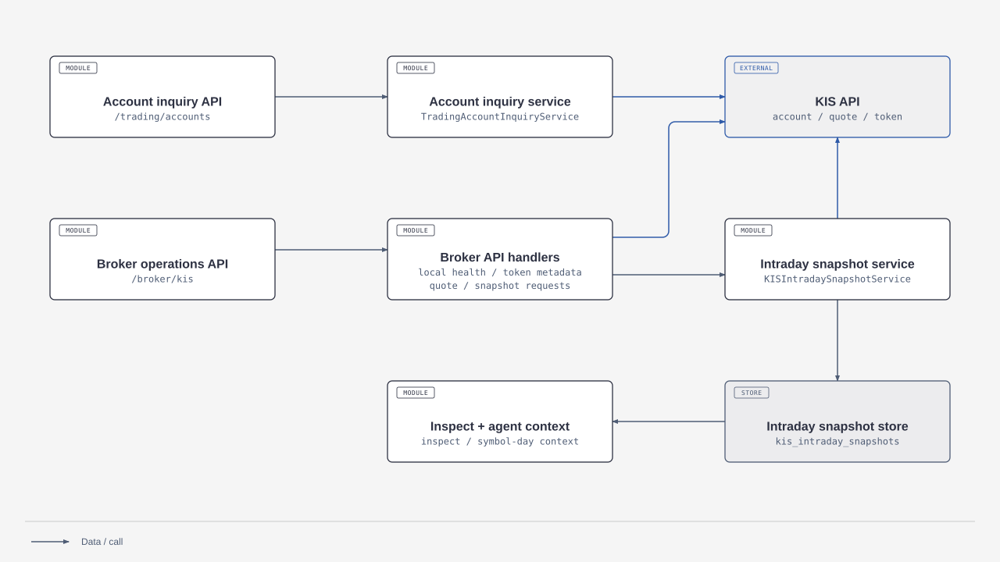

- Health reads local configuration and runtime snapshots; it does not probe the remote broker. Token and quote operations can make KIS requests.
- The token route requires the configured upstream bearer token and returns presence, type, expiry and cache metadata rather than the access token.
- KIS_MIN_REQUEST_INTERVAL_SECONDS defaults to 0.0, which disables the request-slot limiter. Positive values pace regular KISClient requests and required hashkey calls within that client instance, not across Core and Exec processes.
- No account contents, tokens, live provider responses or deployment settings were accessed during this source analysis.

**HTTP coverage:** `/trading/accounts`, `/broker/kis`.

**Implementation evidence**

- [`apps/api/app/api/routes_trading_accounts.py`](https://github.com/kiseyno-AI/kai-trading-core/blob/5a0ce6b4260d47c7cc8177f67be5b29f1811f2c7/apps/api/app/api/routes_trading_accounts.py#L15-L75) — summary / positions / buying-power routes
- [`apps/api/app/orders/account_inquiry_service.py`](https://github.com/kiseyno-AI/kai-trading-core/blob/5a0ce6b4260d47c7cc8177f67be5b29f1811f2c7/apps/api/app/orders/account_inquiry_service.py#L119-L142) — get_account_summary
- [`apps/api/app/orders/account_inquiry_service.py`](https://github.com/kiseyno-AI/kai-trading-core/blob/5a0ce6b4260d47c7cc8177f67be5b29f1811f2c7/apps/api/app/orders/account_inquiry_service.py#L209-L227) — get_positions
- [`apps/api/app/orders/account_inquiry_service.py`](https://github.com/kiseyno-AI/kai-trading-core/blob/5a0ce6b4260d47c7cc8177f67be5b29f1811f2c7/apps/api/app/orders/account_inquiry_service.py#L349-L387) — get_buying_power
- [`apps/api/app/api/routes_kis.py`](https://github.com/kiseyno-AI/kai-trading-core/blob/5a0ce6b4260d47c7cc8177f67be5b29f1811f2c7/apps/api/app/api/routes_kis.py#L19-L104) — local health / token authorization and metadata / quote
- [`apps/api/app/api/routes_kis.py`](https://github.com/kiseyno-AI/kai-trading-core/blob/5a0ce6b4260d47c7cc8177f67be5b29f1811f2c7/apps/api/app/api/routes_kis.py#L107-L156) — intraday collection and inspection routes
- [`apps/api/app/brokers/kis/client.py`](https://github.com/kiseyno-AI/kai-trading-core/blob/5a0ce6b4260d47c7cc8177f67be5b29f1811f2c7/apps/api/app/brokers/kis/client.py#L605-L617) — healthcheck returns local metadata
- [`apps/api/app/brokers/kis/client.py`](https://github.com/kiseyno-AI/kai-trading-core/blob/5a0ce6b4260d47c7cc8177f67be5b29f1811f2c7/apps/api/app/brokers/kis/client.py#L136-L155) — per-client request-slot reservation
- [`apps/api/app/brokers/kis/client.py`](https://github.com/kiseyno-AI/kai-trading-core/blob/5a0ce6b4260d47c7cc8177f67be5b29f1811f2c7/apps/api/app/brokers/kis/client.py#L714-L740) — hashkey and regular request slots
- [`apps/api/app/core/settings.py`](https://github.com/kiseyno-AI/kai-trading-core/blob/5a0ce6b4260d47c7cc8177f67be5b29f1811f2c7/apps/api/app/core/settings.py#L86-L89) — KIS request interval default and range
- [`apps/api/app/market/kis_intraday_snapshots.py`](https://github.com/kiseyno-AI/kai-trading-core/blob/5a0ce6b4260d47c7cc8177f67be5b29f1811f2c7/apps/api/app/market/kis_intraday_snapshots.py#L964-L987) — persist collected snapshots
- [`apps/api/app/market/kis_intraday_snapshots.py`](https://github.com/kiseyno-AI/kai-trading-core/blob/5a0ce6b4260d47c7cc8177f67be5b29f1811f2c7/apps/api/app/market/kis_intraday_snapshots.py#L1114-L1141) — inspect current snapshots
- [`apps/api/app/agent_context/read_service.py`](https://github.com/kiseyno-AI/kai-trading-core/blob/5a0ce6b4260d47c7cc8177f67be5b29f1811f2c7/apps/api/app/agent_context/read_service.py#L6912-L6919) — get_symbol_day_context loads current intraday data

<a id="learning"></a>

## Evaluation and weekly advisory feedback

Stored decisions are evaluated against subsequent prices. Mature evaluation cohorts and eligible actual execution evidence feed an immutable weekly artifact whose criteria can inform later decisions.

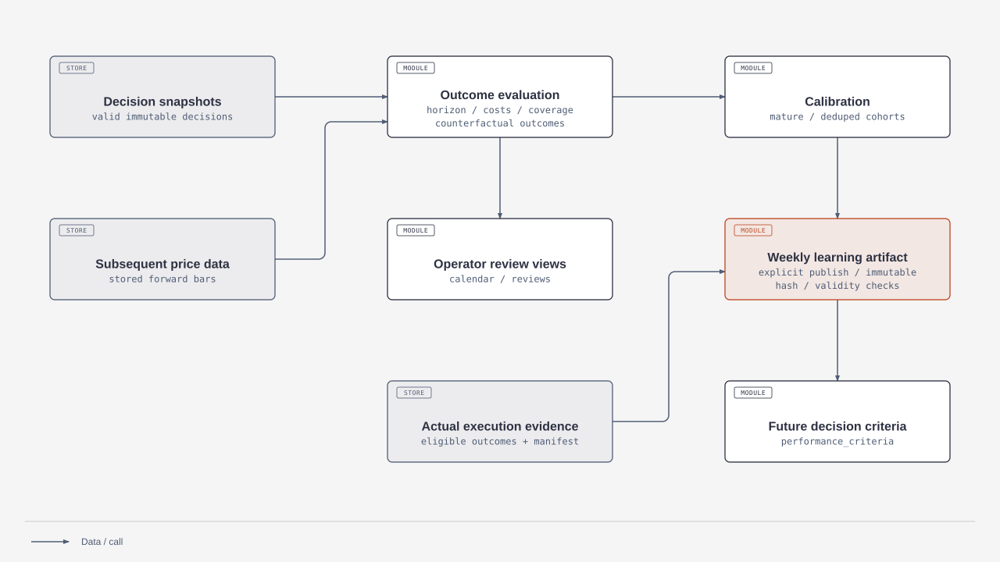

- Publication is explicit. Future dispatch automatically selects eligible, effective, nonexpired artifacts and supplies performance_criteria to both deciders.
- These artifacts provide advisory context. They do not train model weights, activate candidate policies or grant order authority.
- Evaluation is omitted from the default EOD chain; explicit maintenance/API and optional startup catch-up are separate paths.
- The contract-note improvement workflow is a separate path: signal-lab findings can produce guarded pull requests, not weekly-learning database artifacts.

**HTTP coverage:** `/agent-context`.

**Implementation evidence**

- [`apps/api/app/agent_context/signal_decider_loop_service.py`](https://github.com/kiseyno-AI/kai-trading-core/blob/5a0ce6b4260d47c7cc8177f67be5b29f1811f2c7/apps/api/app/agent_context/signal_decider_loop_service.py#L4032-L4345) — SignalDeciderLoopService.compute_evaluations
- [`apps/api/app/agent_context/decider_evaluation_service.py`](https://github.com/kiseyno-AI/kai-trading-core/blob/5a0ce6b4260d47c7cc8177f67be5b29f1811f2c7/apps/api/app/agent_context/decider_evaluation_service.py#L850-L965) — compute_evaluations
- [`apps/api/app/agent_context/signal_decider_calibration_service.py`](https://github.com/kiseyno-AI/kai-trading-core/blob/5a0ce6b4260d47c7cc8177f67be5b29f1811f2c7/apps/api/app/agent_context/signal_decider_calibration_service.py#L413-L702) — SignalDeciderCalibrationService.build_report
- [`apps/api/app/agent_context/signal_decider_weekly_learning_service.py`](https://github.com/kiseyno-AI/kai-trading-core/blob/5a0ce6b4260d47c7cc8177f67be5b29f1811f2c7/apps/api/app/agent_context/signal_decider_weekly_learning_service.py#L900-L1149) — SignalDeciderWeeklyLearningService.publish
- [`apps/api/app/agent_context/signal_decider_weekly_learning_service.py`](https://github.com/kiseyno-AI/kai-trading-core/blob/5a0ce6b4260d47c7cc8177f67be5b29f1811f2c7/apps/api/app/agent_context/signal_decider_weekly_learning_service.py#L1188-L1384) — get_latest_published / get_latest_performance_criteria
- [`apps/api/app/agent_context/orchestrator.py`](https://github.com/kiseyno-AI/kai-trading-core/blob/5a0ce6b4260d47c7cc8177f67be5b29f1811f2c7/apps/api/app/agent_context/orchestrator.py#L5216-L5305) — _build_decider_policy_context / _load_published_weekly_performance_criteria
- [`apps/api/app/agent_context/signal_decider_calendar_review_service.py`](https://github.com/kiseyno-AI/kai-trading-core/blob/5a0ce6b4260d47c7cc8177f67be5b29f1811f2c7/apps/api/app/agent_context/signal_decider_calendar_review_service.py#L449-L570) — SignalDeciderCalendarReviewService.refresh_reviews
- [`apps/api/app/eod/daily_pipeline_stages.py`](https://github.com/kiseyno-AI/kai-trading-core/blob/5a0ce6b4260d47c7cc8177f67be5b29f1811f2c7/apps/api/app/eod/daily_pipeline_stages.py#L222-L259) — DAILY_STAGE_ORDER / DEFAULT_DAILY_STAGE_ORDER
- [`apps/api/app/main.py`](https://github.com/kiseyno-AI/kai-trading-core/blob/5a0ce6b4260d47c7cc8177f67be5b29f1811f2c7/apps/api/app/main.py#L97-L152) — _run_startup_maintenance / lifespan
- [`apps/api/app/agent_context/signal_decider_evaluation_maintenance_service.py`](https://github.com/kiseyno-AI/kai-trading-core/blob/5a0ce6b4260d47c7cc8177f67be5b29f1811f2c7/apps/api/app/agent_context/signal_decider_evaluation_maintenance_service.py#L123-L239) — refresh_recent_coverage

<a id="policy"></a>

## Candidate policy replay and activation

Calibration candidates pass through explicit replay and activation. Before promoting a new candidate, the server reruns the replay and validates the submitted evidence.

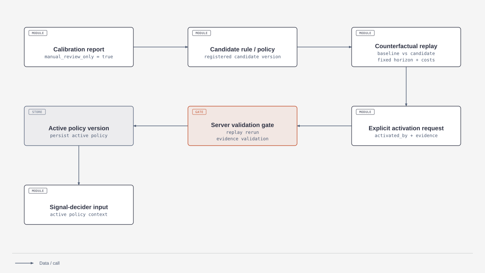

- Calibration reports set auto_apply_prompt_changes and auto_apply_policy_changes to false.
- The diagram shows promotion of a new candidate. Requests for an already-active policy follow a separate idempotent branch.
- A guarded calibration-note pull request is also separate from this database policy activation path; merging a note does not call this activation API.

**HTTP coverage:** `/agent-context`.

**Implementation evidence**

- [`apps/api/app/agent_context/signal_decider_calibration_service.py`](https://github.com/kiseyno-AI/kai-trading-core/blob/5a0ce6b4260d47c7cc8177f67be5b29f1811f2c7/apps/api/app/agent_context/signal_decider_calibration_service.py#L413-L702) — SignalDeciderCalibrationService.build_report
- [`apps/api/app/agent_context/decider_replay_service.py`](https://github.com/kiseyno-AI/kai-trading-core/blob/5a0ce6b4260d47c7cc8177f67be5b29f1811f2c7/apps/api/app/agent_context/decider_replay_service.py#L2033-L2189) — DeciderReplayService.replay
- [`apps/api/app/agent_context/signal_decider_loop_service.py`](https://github.com/kiseyno-AI/kai-trading-core/blob/5a0ce6b4260d47c7cc8177f67be5b29f1811f2c7/apps/api/app/agent_context/signal_decider_loop_service.py#L2742-L2838) — SignalDeciderLoopService.activate_policy_version
- [`apps/api/app/agent_context/orchestrator.py`](https://github.com/kiseyno-AI/kai-trading-core/blob/5a0ce6b4260d47c7cc8177f67be5b29f1811f2c7/apps/api/app/agent_context/orchestrator.py#L5216-L5305) — _build_decider_policy_context / _load_published_weekly_performance_criteria

<a id="signal-lab"></a>

## Read-only signal evaluation lab

Stored KRX bars, factor scores and timestamped agent observations form a shared evaluation panel. Pure scoring functions test rank evidence and non-overlapping top-k returns, then the CLI writes local research reports.

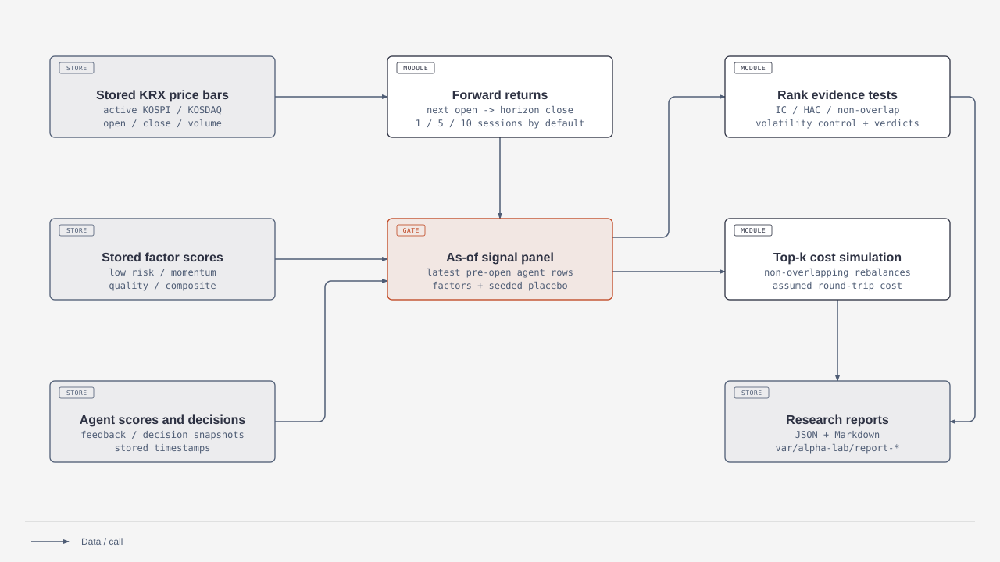

- The loader explicitly starts a read-only database transaction. The module writes report files and has no order-submission path.
- Agent rows stored at or after the next session open, rows with unknown stored times and dates without a next session are excluded. The latest admitted row per symbol/date wins.
- Returns enter at the next open and exit at the horizon close. Missing or halted entries are excluded on the shared session calendar.
- The lab reports multiplicity-adjusted IC verdicts, non-overlapping and split-sample checks, volatility-controlled partial IC, and top-k cost sensitivity. Simulated returns and cost assumptions are research evidence, not realized fills.
- This CLI is separate from the persisted decider-evaluation and weekly-artifact services. It is not a new FastAPI route or an automatic execution policy.

**Implementation evidence**

- [`apps/api/app/analytics/signal_lab.py`](https://github.com/kiseyno-AI/kai-trading-core/blob/5a0ce6b4260d47c7cc8177f67be5b29f1811f2c7/apps/api/app/analytics/signal_lab.py#L67-L163) — load_panel
- [`apps/api/app/analytics/signal_lab.py`](https://github.com/kiseyno-AI/kai-trading-core/blob/5a0ce6b4260d47c7cc8177f67be5b29f1811f2c7/apps/api/app/analytics/signal_lab.py#L171-L228) — evaluate_panel
- [`apps/api/app/analytics/signal_lab.py`](https://github.com/kiseyno-AI/kai-trading-core/blob/5a0ce6b4260d47c7cc8177f67be5b29f1811f2c7/apps/api/app/analytics/signal_lab.py#L339-L362) — main
- [`apps/api/app/analytics/signal_evaluation.py`](https://github.com/kiseyno-AI/kai-trading-core/blob/5a0ce6b4260d47c7cc8177f67be5b29f1811f2c7/apps/api/app/analytics/signal_evaluation.py#L36-L107) — admit_before_next_open / forward_returns
- [`apps/api/app/analytics/signal_evaluation.py`](https://github.com/kiseyno-AI/kai-trading-core/blob/5a0ce6b4260d47c7cc8177f67be5b29f1811f2c7/apps/api/app/analytics/signal_evaluation.py#L118-L226) — cross_sectional_ic / partial_cross_sectional_ic / summarize_ic / verdict
- [`apps/api/app/analytics/signal_evaluation.py`](https://github.com/kiseyno-AI/kai-trading-core/blob/5a0ce6b4260d47c7cc8177f67be5b29f1811f2c7/apps/api/app/analytics/signal_evaluation.py#L254-L307) — simulate_topk

<a id="agent-improvement"></a>

## Guarded weekly agent improvement

An optional local schedule runs the signal lab and deterministic findings. Dry-run is the default; opt-in application can propose bounded decider calibration notes by pull request or open deduplicated code issues.

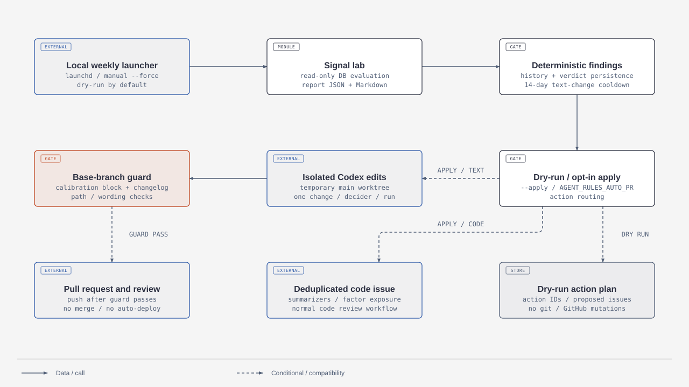

- The launchd template checks hourly; the wrapper admits one scheduled run per ISO week on Saturday from 09:00 KST. Installation and apply mode are opt-in, and deployed scheduling was not inspected.
- Findings require persistent report verdicts. Decider text changes additionally observe a global cooldown; summarizer changes and qualifying deterministic factors become code issues. Positive agent-skill observations are logged only.
- Codex works in a temporary worktree of origin/main. The local runner saves the base branch guard outside that worktree and runs it with python -I before pushing.
- Only the marked AUTO-CALIBRATION block in the two decider contracts and the append-only changelog may change. Execution, risk, order and gate code are outside the allowed paths.
- The loop never merges a PR. Live contract synchronization remains a separate post-merge action; automatic deployment is not wired.
- The introduction document explicitly says the scheduled run, Codex invocation and PR creation had not yet been exercised. This diagram describes implemented control flow, not verified production activity.

**Implementation evidence**

- [`scripts/run_agent_improvement_local.sh`](https://github.com/kiseyno-AI/kai-trading-core/blob/5a0ce6b4260d47c7cc8177f67be5b29f1811f2c7/scripts/run_agent_improvement_local.sh#L1-L54) — schedule, report/findings collection and opt-in apply
- [`apps/api/app/analytics/improvement_findings.py`](https://github.com/kiseyno-AI/kai-trading-core/blob/5a0ce6b4260d47c7cc8177f67be5b29f1811f2c7/apps/api/app/analytics/improvement_findings.py#L20-L124) — build_findings / streak / cooldown constants
- [`scripts/agent_improvement_run.py`](https://github.com/kiseyno-AI/kai-trading-core/blob/5a0ce6b4260d47c7cc8177f67be5b29f1811f2c7/scripts/agent_improvement_run.py#L154-L245) — _propose_change / execute
- [`scripts/agent_rules_guard.py`](https://github.com/kiseyno-AI/kai-trading-core/blob/5a0ce6b4260d47c7cc8177f67be5b29f1811f2c7/scripts/agent_rules_guard.py#L80-L118) — validate
- [`agent_rules/POLICY.md`](https://github.com/kiseyno-AI/kai-trading-core/blob/5a0ce6b4260d47c7cc8177f67be5b29f1811f2c7/agent_rules/POLICY.md#L1-L16) — permitted calibration-note scope
- [`.github/workflows/agent-rules-guard.yml`](https://github.com/kiseyno-AI/kai-trading-core/blob/5a0ce6b4260d47c7cc8177f67be5b29f1811f2c7/.github/workflows/agent-rules-guard.yml#L17-L32) — base-branch guard workflow
- [`.github/workflows/auto-comment.yml`](https://github.com/kiseyno-AI/kai-trading-core/blob/5a0ce6b4260d47c7cc8177f67be5b29f1811f2c7/.github/workflows/auto-comment.yml#L3-L21) — PR-open Codex review request
- [`docs/AGENT_IMPROVEMENT_LOOP.md`](https://github.com/kiseyno-AI/kai-trading-core/blob/5a0ce6b4260d47c7cc8177f67be5b29f1811f2c7/docs/AGENT_IMPROVEMENT_LOOP.md#L42-L66) — manual installation, deployment boundary and verification limits

<a id="us-equities"></a>

## US equity pipeline and execution boundary

The US scheduler runs universe refresh, price screening, SEC screening, agent analysis and execution planning in order. This plan-service path currently produces previews only.

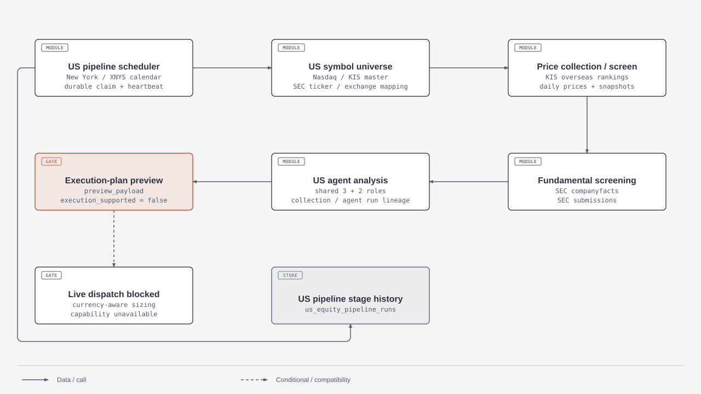

- Plans may contain next_open_buy, target_sell and stop_sell items, but payload is None; only preview_payload is exposed.
- This boundary belongs to us_equities/execution_plan_service.py. It does not describe every generic direct-order compatibility route.
- Defaults: US automatic pipeline disabled, US execution disabled, and the US pipeline Exec dry run enabled. Deployment settings were not checked.
- Universe source reads run concurrently. Candidate history and SEC collection use bounded concurrency, while the scheduler waits for clean stage completion and checks collection/run lineage.

**HTTP coverage:** `/us-equities`.

**Implementation evidence**

- [`apps/api/app/us_equities/scheduler.py`](https://github.com/kiseyno-AI/kai-trading-core/blob/5a0ce6b4260d47c7cc8177f67be5b29f1811f2c7/apps/api/app/us_equities/scheduler.py#L129-L260) — USEquityPipelineScheduler.run_if_due / _run_pipeline
- [`apps/api/app/us_equities/universe_service.py`](https://github.com/kiseyno-AI/kai-trading-core/blob/5a0ce6b4260d47c7cc8177f67be5b29f1811f2c7/apps/api/app/us_equities/universe_service.py#L36-L100) — USUniverseRefreshService.refresh
- [`apps/api/app/us_equities/price_collection_service.py`](https://github.com/kiseyno-AI/kai-trading-core/blob/5a0ce6b4260d47c7cc8177f67be5b29f1811f2c7/apps/api/app/us_equities/price_collection_service.py#L136-L257) — USPriceCollectionService.collect_and_screen
- [`apps/api/app/us_equities/fundamental_collection_service.py`](https://github.com/kiseyno-AI/kai-trading-core/blob/5a0ce6b4260d47c7cc8177f67be5b29f1811f2c7/apps/api/app/us_equities/fundamental_collection_service.py#L62-L178) — USFundamentalCollectionService.collect_and_screen
- [`apps/api/app/us_equities/agent_analysis_service.py`](https://github.com/kiseyno-AI/kai-trading-core/blob/5a0ce6b4260d47c7cc8177f67be5b29f1811f2c7/apps/api/app/us_equities/agent_analysis_service.py#L354-L531) — USAgentAnalysisService.dispatch
- [`apps/api/app/us_equities/execution_plan_service.py`](https://github.com/kiseyno-AI/kai-trading-core/blob/5a0ce6b4260d47c7cc8177f67be5b29f1811f2c7/apps/api/app/us_equities/execution_plan_service.py#L62-L280) — build / dispatch preview boundary
- [`apps/api/app/core/settings.py`](https://github.com/kiseyno-AI/kai-trading-core/blob/5a0ce6b4260d47c7cc8177f67be5b29f1811f2c7/apps/api/app/core/settings.py#L165-L175) — US execution and pipeline defaults

<a id="crypto"></a>

## Crypto quotes and analysis context

Crypto reads public Upbit quotations and derives deterministic analysis context. This module provides research and decision support without private-account access or order submission.

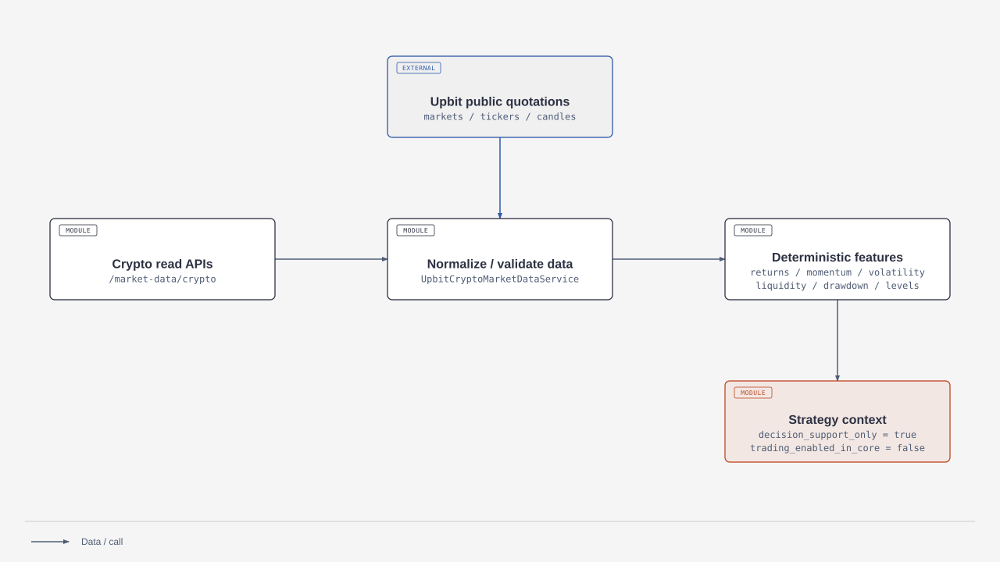

- The service uses a configured market allowlist and reports private_api_used=false and account_data_used=false.
- Context status is available, partial or unavailable, based on the returned ticker/candle inputs. Its usage scope is paper_research_only.

**HTTP coverage:** `/market-data/crypto`.

**Implementation evidence**

- [`apps/api/app/api/routes_crypto.py`](https://github.com/kiseyno-AI/kai-trading-core/blob/5a0ce6b4260d47c7cc8177f67be5b29f1811f2c7/apps/api/app/api/routes_crypto.py#L15-L77) — public market and strategy-context routes
- [`apps/api/app/crypto/market_data.py`](https://github.com/kiseyno-AI/kai-trading-core/blob/5a0ce6b4260d47c7cc8177f67be5b29f1811f2c7/apps/api/app/crypto/market_data.py#L97-L219) — UpbitCryptoMarketDataService and allowlist validation
- [`apps/api/app/crypto/market_data.py`](https://github.com/kiseyno-AI/kai-trading-core/blob/5a0ce6b4260d47c7cc8177f67be5b29f1811f2c7/apps/api/app/crypto/market_data.py#L59-L94) — read-only source / instrument metadata
- [`apps/api/app/crypto/strategy_context.py`](https://github.com/kiseyno-AI/kai-trading-core/blob/5a0ce6b4260d47c7cc8177f67be5b29f1811f2c7/apps/api/app/crypto/strategy_context.py#L29-L89) — CryptoStrategyContextService.get_strategy_context
- [`apps/api/app/crypto/strategy_context.py`](https://github.com/kiseyno-AI/kai-trading-core/blob/5a0ce6b4260d47c7cc8177f67be5b29f1811f2c7/apps/api/app/crypto/strategy_context.py#L92-L208) — build_crypto_strategy_context_item

## Graphify source graph

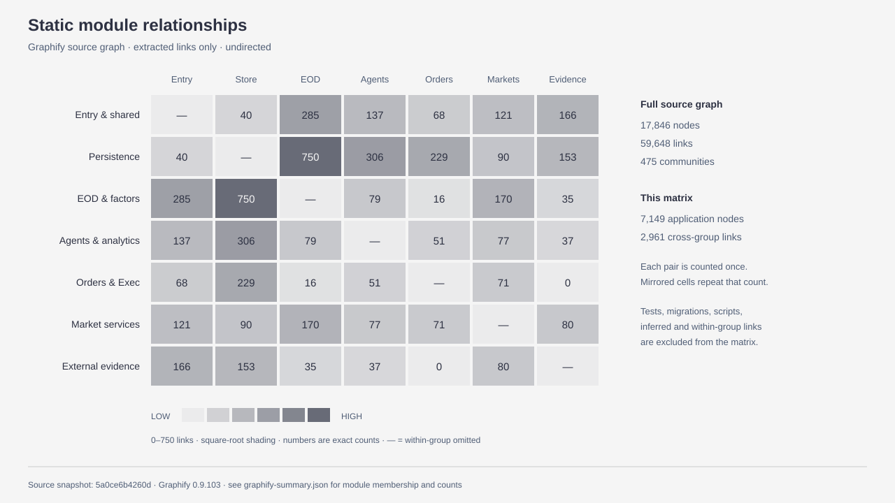

Count EXTRACTED Graphify links whose endpoint source files both belong to apps/api/app, grouping by the immediate module. Count each cross-group link once; exclude within-group links, inferred links, tests, migrations, and scripts. Symmetric matrix cells show the same count. This is static source structure, not runtime call frequency.

The full graph includes test and migration symbols; its node count is not a count of production components. Graphify's raw graph is undirected. Arrow directions in the feature diagrams were assigned by reading the cited code, rather than inferred from this matrix.

| Measure | Value | Definition |
| --- | ---: | --- |
| nodes | 17,846 | Entries in graph.json nodes |
| edges | 59,648 | Entries in graph.json links |
| communities | 475 | Distinct node community IDs after clustering |
| extracted_edges | 53,954 | Links whose confidence is EXTRACTED |
| inferred_edges | 5,694 | Links whose confidence is INFERRED |
| self_loops | 69 | Links with identical source and target IDs |
| dangling_endpoints | 0 | Links with a source or target absent from the node set |
| application_nodes | 7,149 | Nodes whose source_file starts with apps/api/app/ |
| cross_group_extracted_edges | 2,961 | Extracted application links with endpoints in different groups; counted once |

### Module grouping

| Group | Immediate application modules | Nodes |
| --- | --- | ---: |
| Entry & shared | `main`, `api`, `internal`, `core`, `schemas`, `brokers` | 605 |
| Persistence | `db`, `db_models`, `market_data_store`, `repositories`, `db_pool_watchdog` | 407 |
| EOD & factors | `eod`, `signals` | 2,039 |
| Agents & analytics | `agent_context`, `side_agents`, `analytics` | 1,746 |
| Orders & Exec | `orders` | 1,059 |
| Market services | `market`, `quotes`, `scanner`, `us_equities`, `crypto` | 566 |
| External evidence | `dart`, `integrations`, `external_news`, `macro_context`, `market_news`, `external_context`, `fx` | 727 |

Counts and extraction metadata are stored in [graphify-summary.json](graphify-summary.json). Graph links count static relationships, not traffic, latency, defects, or trading performance.

## HTTP surface coverage

The inventory below counts decorators in the 18 registered router modules. It excludes `/health` in `main.py` and FastAPI's generated documentation routes.

| Router prefix | Routes | Feature diagrams |
| --- | ---: | --- |
| [`/agent-context`](https://github.com/kiseyno-AI/kai-trading-core/blob/5a0ce6b4260d47c7cc8177f67be5b29f1811f2c7/apps/api/app/api/routes_agent_context.py) | 48 | [Per-symbol decision context](#context), [Three summaries, two decision lanes](#agents), [Response validation, retries and history](#feedback), [Evaluation and weekly advisory feedback](#learning), [Candidate policy replay and activation](#policy) |
| [`/market-data/crypto`](https://github.com/kiseyno-AI/kai-trading-core/blob/5a0ce6b4260d47c7cc8177f67be5b29f1811f2c7/apps/api/app/api/routes_crypto.py) | 4 | [Crypto quotes and analysis context](#crypto) |
| [`/disclosures/dart`](https://github.com/kiseyno-AI/kai-trading-core/blob/5a0ce6b4260d47c7cc8177f67be5b29f1811f2c7/apps/api/app/api/routes_dart.py) | 12 | [DART incremental fundamentals](#dart) |
| [`/eod`](https://github.com/kiseyno-AI/kai-trading-core/blob/5a0ce6b4260d47c7cc8177f67be5b29f1811f2c7/apps/api/app/api/routes_eod.py) | 43 | [Korean EOD execution and recovery](#eod-orchestration), [Daily price collection priority](#eod-price), [EOD derived data and factor inputs](#eod-derived), [Gap filling and audited price repair](#data-repair) |
| [`/execution/runtime`](https://github.com/kiseyno-AI/kai-trading-core/blob/5a0ce6b4260d47c7cc8177f67be5b29f1811f2c7/apps/api/app/api/routes_execution_runtime.py) | 4 | [KR plan registration, activation and readback](#execution), [Execution, price and portfolio read models](#monitoring) |
| [`/external/news`](https://github.com/kiseyno-AI/kai-trading-core/blob/5a0ce6b4260d47c7cc8177f67be5b29f1811f2c7/apps/api/app/api/routes_external_news.py) | 6 | [External news and macro evidence](#external-evidence) |
| [`/symbols/favorites`](https://github.com/kiseyno-AI/kai-trading-core/blob/5a0ce6b4260d47c7cc8177f67be5b29f1811f2c7/apps/api/app/api/routes_favorite_symbols.py) | 2 | [Korean symbols, favorites and scanners](#market-discovery) |
| [`/fx/koreaexim`](https://github.com/kiseyno-AI/kai-trading-core/blob/5a0ce6b4260d47c7cc8177f67be5b29f1811f2c7/apps/api/app/api/routes_fx.py) | 1 | [Market snapshots and FX](#market-fx) |
| [`/broker/kis`](https://github.com/kiseyno-AI/kai-trading-core/blob/5a0ce6b4260d47c7cc8177f67be5b29f1811f2c7/apps/api/app/api/routes_kis.py) | 5 | [Account inquiries and broker operations](#operations) |
| [`/macro`](https://github.com/kiseyno-AI/kai-trading-core/blob/5a0ce6b4260d47c7cc8177f67be5b29f1811f2c7/apps/api/app/api/routes_macro.py) | 5 | [External news and macro evidence](#external-evidence) |
| [`/market`](https://github.com/kiseyno-AI/kai-trading-core/blob/5a0ce6b4260d47c7cc8177f67be5b29f1811f2c7/apps/api/app/api/routes_market.py) | 4 | [Market snapshots and FX](#market-fx) |
| [`/portfolio`](https://github.com/kiseyno-AI/kai-trading-core/blob/5a0ce6b4260d47c7cc8177f67be5b29f1811f2c7/apps/api/app/api/routes_portfolio.py) | 1 | [Execution, price and portfolio read models](#monitoring) |
| [`/quotes`](https://github.com/kiseyno-AI/kai-trading-core/blob/5a0ce6b4260d47c7cc8177f67be5b29f1811f2c7/apps/api/app/api/routes_quotes.py) | 4 | [Korean quotes and fallbacks](#quotes), [Execution, price and portfolio read models](#monitoring) |
| [`/scanner`](https://github.com/kiseyno-AI/kai-trading-core/blob/5a0ce6b4260d47c7cc8177f67be5b29f1811f2c7/apps/api/app/api/routes_scanner.py) | 4 | [Korean symbols, favorites and scanners](#market-discovery) |
| [`/symbols`](https://github.com/kiseyno-AI/kai-trading-core/blob/5a0ce6b4260d47c7cc8177f67be5b29f1811f2c7/apps/api/app/api/routes_symbols.py) | 2 | [Korean symbols, favorites and scanners](#market-discovery) |
| [`/trading/orders`](https://github.com/kiseyno-AI/kai-trading-core/blob/5a0ce6b4260d47c7cc8177f67be5b29f1811f2c7/apps/api/app/api/routes_trading.py) | 20 | [KR plan registration, activation and readback](#execution), [Direct domestic orders and reconciliation](#orders), [Compatibility auto-sell from linked positions](#auto-sell) |
| [`/trading/accounts`](https://github.com/kiseyno-AI/kai-trading-core/blob/5a0ce6b4260d47c7cc8177f67be5b29f1811f2c7/apps/api/app/api/routes_trading_accounts.py) | 3 | [Account inquiries and broker operations](#operations) |
| [`/us-equities`](https://github.com/kiseyno-AI/kai-trading-core/blob/5a0ce6b4260d47c7cc8177f67be5b29f1811f2c7/apps/api/app/api/routes_us_equities.py) | 7 | [US equity pipeline and execution boundary](#us-equities) |
| **Total** | **175** | |

## Updating these diagrams

The editable source is [model.json](model.json); it contains node labels, explicit connector routes, notes, source anchors, and the API inventory. SVGs use local system fonts and no external scripts or images.

1. Verify affected source paths and refresh their anchors against the intended commit.
2. Edit the relevant diagram in `docs/architecture/model.json`. Keep each view focused on one responsibility.
3. From the repository root, regenerate the SVGs and this catalog:

```bash
python3 scripts/render_architecture.py
```

4. Check the rendered SVGs, local Markdown links, and `git diff --check` before committing.

To refresh source discovery, use Graphify's local, code-only backend:

```bash
GRAPHIFY_BACKEND=none graphify extract . --code-only
GRAPHIFY_BACKEND=none graphify cluster-only . --no-label
GRAPHIFY_BACKEND=none graphify diagnose multigraph --json --max-examples 2
```

The raw graph is a local analysis artifact and is not committed. To rebuild the compact summary after extraction, run:

```bash
python3 scripts/render_architecture.py --refresh-graph
```

Refresh the model's source commit and verify changed behavior as well; a new graph alone does not verify diagram semantics. The renderer never imports Core, opens a database, contacts a provider, dispatches an agent, or places an order.
